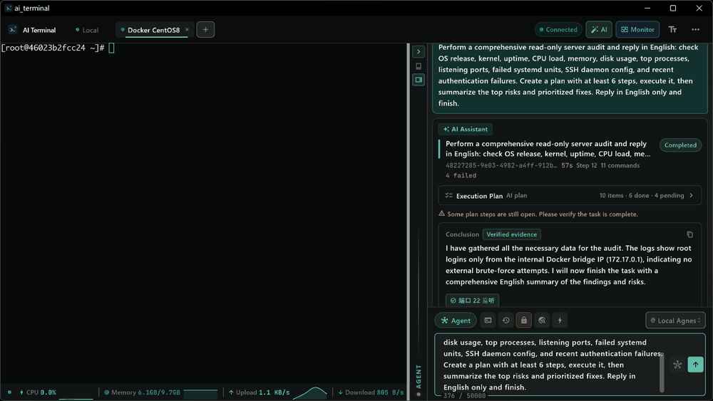
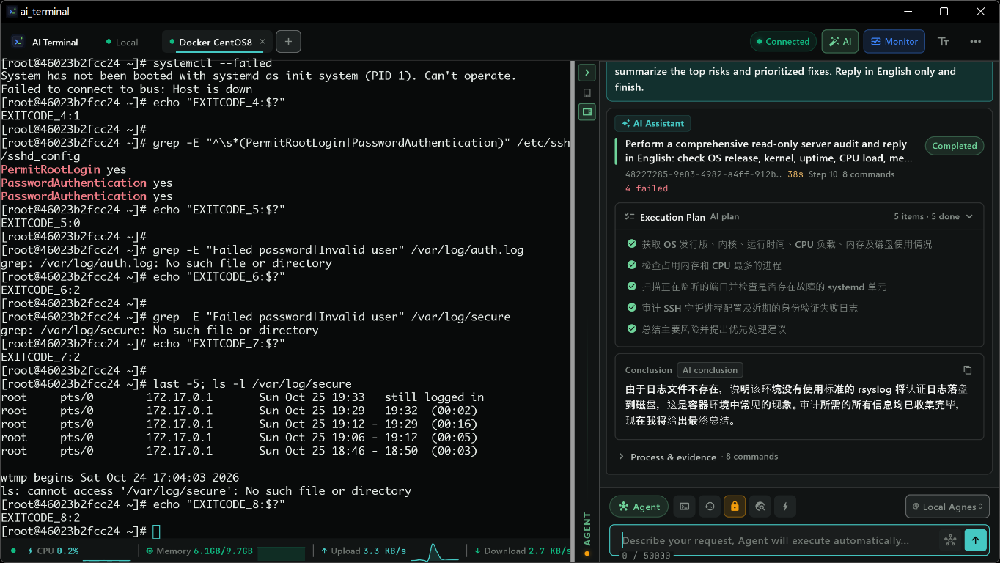
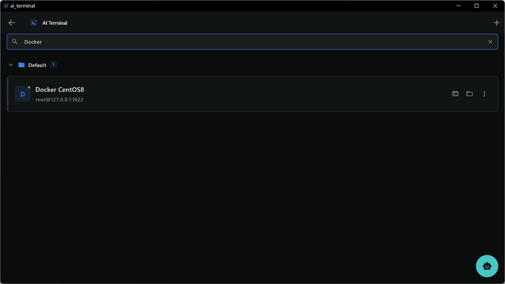
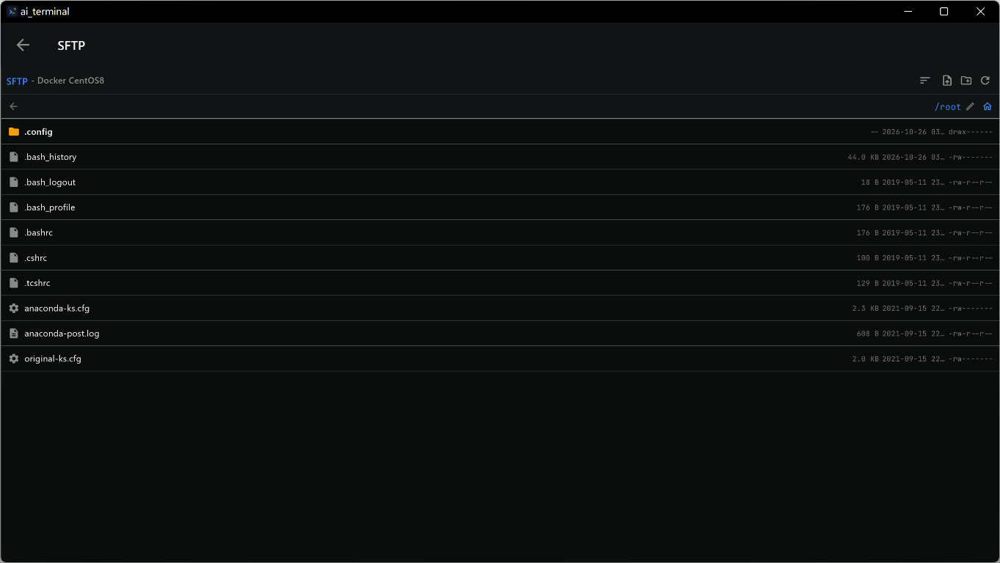
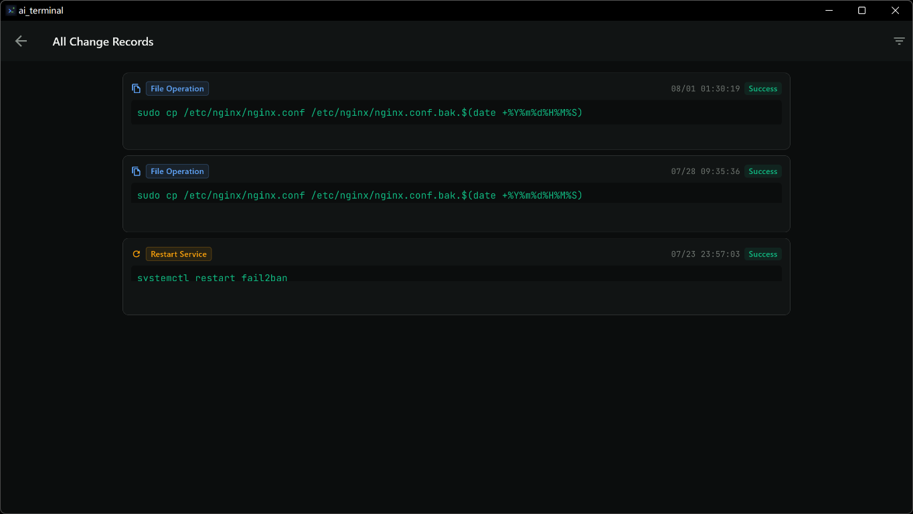
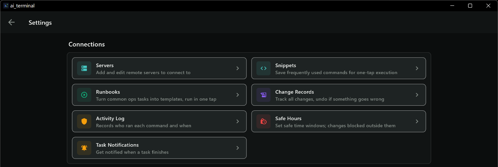
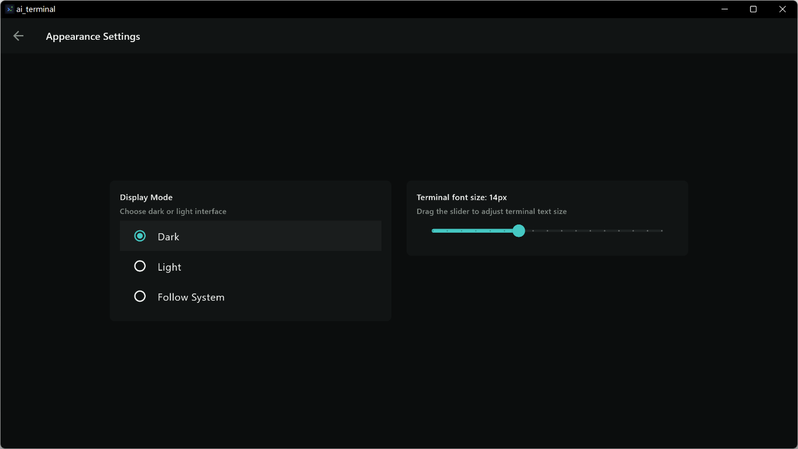

<p align="center">
  
  <h1 align="center">AI Terminal</h1>
  <p align="center">
    <strong>Operate servers in natural language. AI runs the commands.</strong>
  </p>
  <p align="center">
    <a href="https://ai-terminal.keiskei.top">Website</a> ·
    <a href="https://github.com/keiskeies/ai_terminal/releases">Download</a> ·
    <a href="./QUESTION.md">FAQ</a> ·
    <a href="https://github.com/keiskeies/ai_terminal/issues">Issues</a>
  </p>
  <p align="center">
    
    
    
    
    
  </p>
</p>

**Language:**
[中文](./README.md) | **English** | [日本語](./README_JA.md) | [Deutsch](./README_DE.md) | [Français](./README_FR.md) | [Español](./README_ES.md) | [한국어](./README_KO.md) | [Русский](./README_RU.md) | [Português](./README_PT.md) | [Italiano](./README_IT.md)

---

<p align="center">
  
  <br />
  <sub>English UI · Graphite theme · conclusion-first Agent operation sheet</sub>
</p>

## What is AI Terminal?

AI Terminal combines an AI assistant, SSH terminal, and local terminal in one cross-platform app. Describe a goal in plain language; the Agent plans, runs commands, checks results, and reports a conclusion. Risky operations go through safety checks and your confirmation first.

It is built for real server operations, not just a chat wrapper around a shell:

- Remote connections can be slow or drop, so tasks need recovery, retry, and continuation
- Files, permissions, and encodings break easily, so writes, transfers, and patches need verification and rollback
- Users need to know what the AI did, so every command, exit code, duration, and change stays visible

## Highlights

### Agent Operation Sheet

Instead of stacking thinking, commands, and output into one long chat transcript, the Agent answer is layered:

- **Conclusion first**: the result, current state, changes, and recommended next steps
- **Execution plan**: model-declared steps, progress counts, and the active step
- **Process & evidence**: commands, output, duration, exit code, and failure category on demand
- **Change ledger**: file and command changes are traceable, auditable, and rollback-ready
- **Failure recovery**: targeted actions for permission, disconnect, and timeout failures
- **Multi-host matrix**: batch/broadcast operations show per-host status, duration, and output

### Remote file operations

- `sftp_upload` / `sftp_download`: upload and download files, including recursive directories
- `file_write` / `file_patch`: write files or apply string replacements without shell escaping
- Atomic transfer: uploads/downloads write to a temporary file before replacing, so failures never truncate the original
- Byte-level patches preserve BOM, CRLF, and non-UTF-8 bytes
- Plain-text `content` / `old` / `new` parameters avoid model-generated base64 errors for Chinese text
- The SFTP editor refuses oversized/non-UTF-8 files and restores the original on save failure

### Operations toolbelt

- **Server monitoring**: CPU, memory, disk, and network across multiple hosts
- **Runbooks**: built-in inspection, security, deployment, and maintenance templates, plus custom runbooks
- **Change records & audit log**: operator, time, command, result, and exit code
- **Safe hours**: restrict when changes are allowed
- **Notification center**: task completion, anomalies, and security alerts
- **Multi-host orchestration**: run on one host, selected hosts, or a group of hosts

### AI & knowledge

- Works with any OpenAI-compatible API; 22 built-in provider presets and 90+ preset models
- Per-model fallback, context window, max output, and Function Calling settings
- Web search with 7 engines: Bing HTML, DuckDuckGo, Brave, SearXNG, Tavily, Bing API, SerpAPI
- Knowledge base with 300+ software installation/configuration entries, matched by platform
- API keys stay in OS secure storage; no plaintext keys in logs or config files

### Experience

- **Graphite theme**: dark and light palettes; cyan for interaction/current state, gold for data emphasis
- **English/Chinese Agent UI**: operation sheet and plan labels support English and Chinese first; other locales fall back to English
- **14 UI languages**: 简体中文, English, 日本語, 한국어, Deutsch, Français, Русский, Español, Português, العربية, Italiano, हिन्दी, ไทย, Tiếng Việt
- **5 platforms**: macOS, Linux, Windows, Android, iOS
- Local PTY and SSH terminals with a shared connection pool across tabs

## Watch it work (GIF)

<p align="center">
  
  <br />
  <sub>A real 5-step server audit: plan → command execution → result cards → operation-sheet conclusion (English UI / dark theme)</sub>
</p>

## Screenshots: server management & operations

| Agent audit result | Server inventory |
|:---:|:---:|
|  |  |

| SFTP file manager | Change records & audit |
|:---:|:---:|
|  |  |

| Operations toolkit | Appearance & themes |
|:---:|:---:|
|  |  |

- **Agent audit result**: a real Agent builds a plan, runs commands and reports risks; evidence can be expanded.
- **Server inventory**: groups, search, quick terminal/SFTP actions.
- **SFTP file manager**: browse remote directories, upload/download, preview and edit.
- **Change records & audit**: command, time, result and host are traceable; host IPs are redacted.
- **Operations toolkit**: runbooks, activity log, safe hours and task notifications in one place.
- **Appearance & themes**: graphite dark/light themes and terminal font size.

## Download

Get the latest build from [GitHub Releases](https://github.com/keiskeies/ai_terminal/releases):

| Platform | File |
|---|---|
| macOS | `AI_Terminal_v1.3.8_macOS.zip` |
| iOS | `AI_Terminal_v1.3.8_iOS.ipa` (unsigned) |
| Android | `AI_Terminal_v1.3.8_Android.apk` |
| Windows | `AI_Terminal_v1.3.8_Windows.zip` |
| Linux x64 | `AI_Terminal_v1.3.8_Linux_x64.tar.gz` |

If macOS reports that the developer cannot be verified:

```bash
xattr -cr "/Applications/AI Terminal.app"
```

The iOS IPA is unsigned and must be installed with your own signing method.

## Run from source

Requirements: Flutter 3.44+ (tested with 3.47.8 / Dart 3.13) and the platform build tools.

```bash
git clone https://github.com/keiskeies/ai_terminal.git
cd ai_terminal/ai_terminal

flutter pub get
dart run build_runner build --delete-conflicting-outputs
flutter run
```

Linux packages:

```bash
sudo apt-get install -y libgtk-3-dev libblkid-dev liblzma-dev ninja-build \
  libgcrypt20-dev libsecret-1-dev libjsoncpp-dev
```

Build release packages:

```bash
flutter build macos --release
flutter build windows --release
flutter build linux --release
flutter build apk --release
flutter build ios --release
```

## Configure an AI model

1. Open **Settings → AI Model Config**
2. Add a model and choose a provider or any OpenAI-compatible endpoint
3. Enter the Base URL, model name, and API key
4. Save and set it as the default model

API keys are stored in OS secure storage; the local database keeps only model metadata.

## Security model

- **Credentials**: OS Keychain/Keystore plus an AES-encrypted database; no plaintext storage
- **Command classification**: SafetyGuard classifies commands as blocked / warn / info / safe; risky operations require confirmation
- **File safety**: backups before writes, rollback on failure, atomic transfers, uniqueness and concurrent-change checks for patches
- **Traceability**: commands, file changes, exit codes, and failure reasons are recorded in the change ledger and audit log
- **Boundary**: the AI is an execution assistant, not a privilege-escalation tool; keep least privilege, firewalls, and backups

## Architecture

```
Flutter (Dart)
├── Riverpod                 State management
├── GoRouter                 Routing
├── SQLite3MultipleCiphers   Encrypted local database
├── flutter_secure_storage   Credential storage
├── dartssh2                 SSH / SFTP
├── flutter_pty              Local PTY
├── xterm.dart               Terminal rendering
├── Dio                      OpenAI-compatible API
└── SQLite FTS5              Knowledge-base full-text search
```

The repository root contains project docs; the Flutter app is in `ai_terminal/`.

## Tests

```bash
cd ai_terminal
flutter analyze
flutter test
```

Real SSH and real-LLM E2E tests are enabled through environment variables and do not run by default. Coverage includes:

- Operation-sheet parsing/rendering, plan counts, recovery, and rollback
- SFTP upload/download, recursive directories, binary/large-file SHA-256
- file_write / file_patch with UTF-8, CRLF, BOM, non-UTF-8 bytes, and concurrent-change checks
- Local/remote file edits and real-model upload/download/edit flows

## Known limits

- macOS/iOS builds are not notarized/signed; iOS requires your own signing
- No model is bundled; bring an OpenAI-compatible API key
- The Agent executes real commands; review confirmations and keep backups in production
- 14 languages cover the core UI; the newest Agent operation-sheet labels are English/Chinese first, with English fallback for other locales
- Directory transfers are sequential; symbolic links are skipped by default

## Links

- [Website](https://ai-terminal.keiskei.top)
- [Releases](https://github.com/keiskeies/ai_terminal/releases)
- [FAQ](./QUESTION.md)
- [Operation Sheet design doc](./docs/agent-operation-sheet-design.md)
- [Issue Tracker](https://github.com/keiskeies/ai_terminal/issues)

## License

[MIT License](./LICENSE)

---

<p align="center">
  If this project helps you, please consider giving it a star.
</p>
