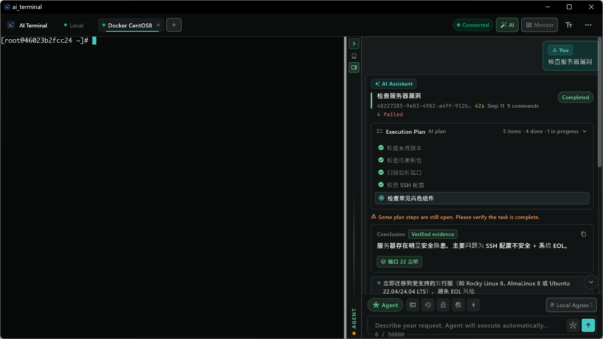

  
  <h1 align="center">AI Terminal</h1>
  
<strong>Pilotez vos serveurs en langage naturel. L’IA exécute les commandes.</strong>

  

    <a href="https://ai-terminal.keiskei.top">Website</a> ·
    <a href="https://github.com/keiskeies/ai_terminal/releases">Download</a> ·
    <a href="https://github.com/keiskeies/ai_terminal/issues">Issues</a>
  

  

    
    
    
  

**Language:**
[中文](./README.md) | [English](./README_EN.md) | [日本語](./README_JA.md) | [Deutsch](./README_DE.md) | [Français](./README_FR.md) | [Español](./README_ES.md) | [한국어](./README_KO.md) | [Русский](./README_RU.md) | [Português](./README_PT.md) | [Italiano](./README_IT.md)

---

> **Translation update in progress**
>
> Cette traduction est en cours de mise à jour pour v1.3.8. Consultez le README anglais ou chinois pour le contenu à jour.
>
> [README anglais](./README_EN.md) · [README chinois](./README.md)

  

