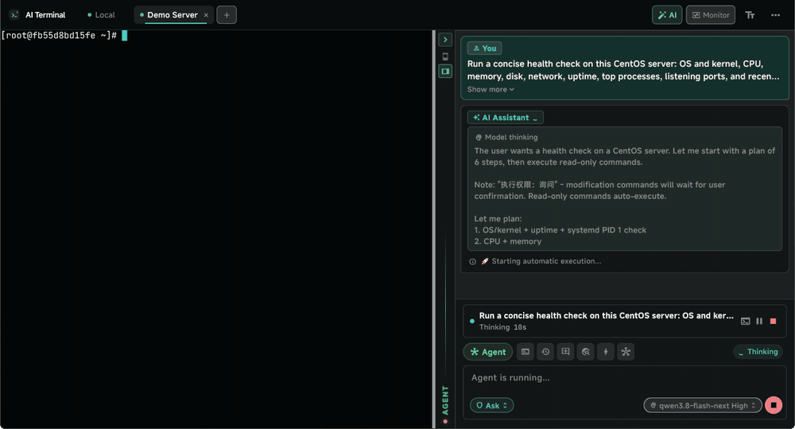
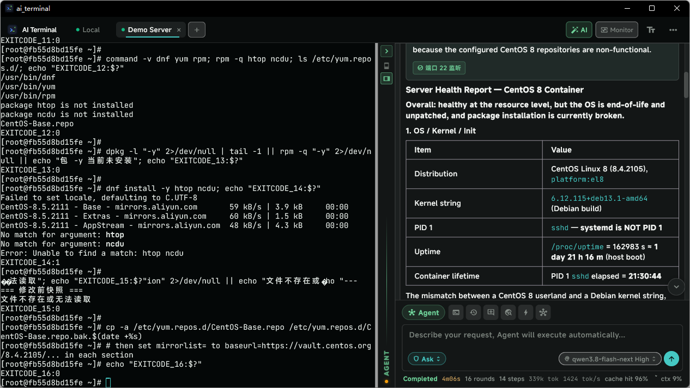
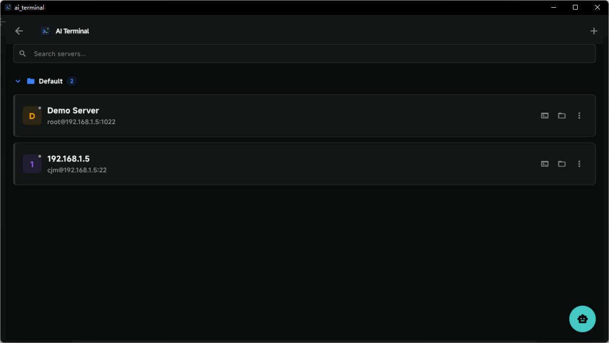
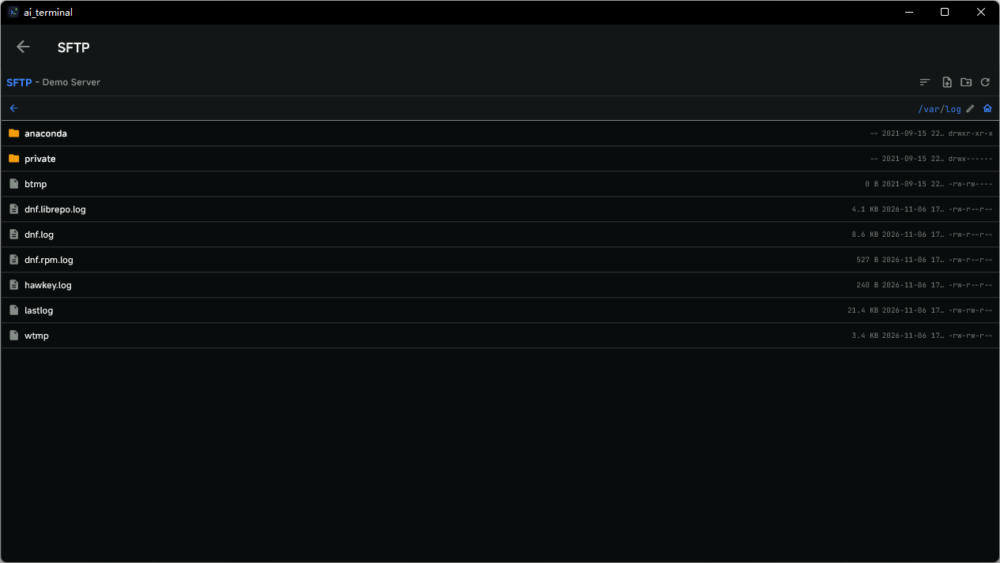
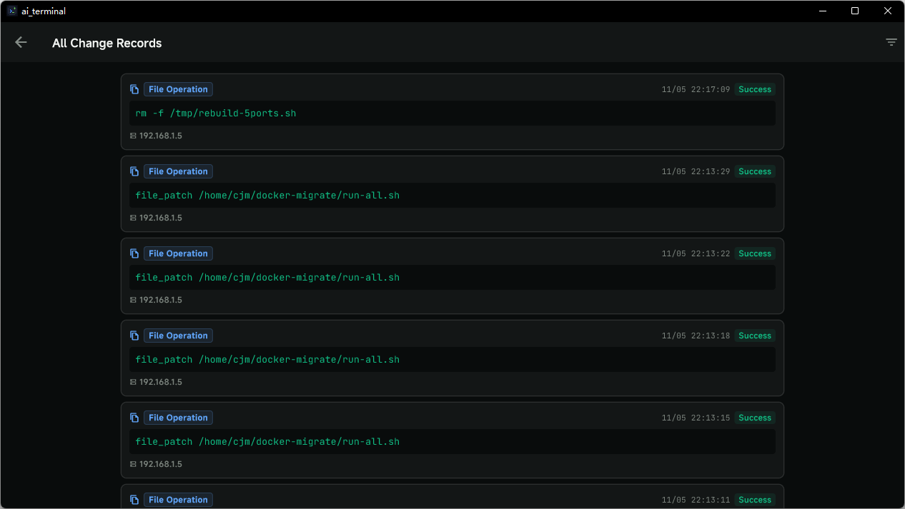
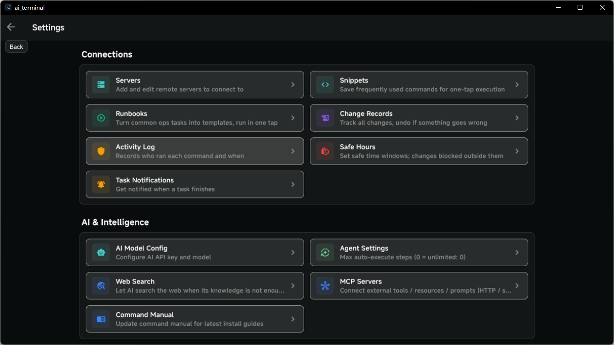
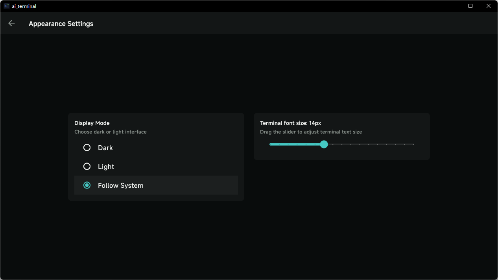

<p align="center">
  
  <h1 align="center">AI Terminal</h1>
  <p align="center">
    <strong>用自然语言操作服务器，AI 替你执行命令</strong>
  </p>
  <p align="center">
    <a href="https://ai-terminal.keiskei.top">官网</a> ·
    <a href="https://github.com/keiskeies/ai_terminal/releases">下载</a> ·
    <a href="https://github.com/keiskeies/ai_terminal/issues">Issues</a>
  </p>
  <p align="center">
    
    
    
    
    
  </p>
</p>

**语言：**
**中文** | [English](./README.md) | [日本語](./README_JA.md) | [Deutsch](./README_DE.md) | [Français](./README_FR.md) | [Español](./README_ES.md) | [한국어](./README_KO.md) | [Русский](./README_RU.md) | [Português](./README_PT.md) | [Italiano](./README_IT.md)

**导航：**
[核心能力](#核心能力) · [场景截图](#场景截图服务器管理与运维) · [下载安装](#下载安装) · [从源码运行](#从源码运行) · [安全设计](#安全设计) · [Star History](#star-history)

---

<p align="center">
  
  <br />
  <sub>真实 Agent 巡检：计划 → 命令执行 → 结果卡片 → 结论与风险；英文界面 / 深色主题</sub>
</p>

<p align="center">
  <a href="https://github.com/keiskeies/ai_terminal/releases"><strong>下载最新版 v1.3.9</strong></a>
  ·
  <a href="https://ai-terminal.keiskei.top">访问官网</a>
</p>

## 为什么是 AI Terminal

普通聊天助手只告诉你怎么做；AI Terminal 直接在你的服务器上完成它，并把过程留成可追溯的操作单。

| 普通聊天式助手 | AI Terminal |
|---|---|
| 给出一段可能需要修改的命令 | 在 SSH / 本地终端实际执行并校验 |
| 对话结束就丢失上下文 | 计划、命令、退出码、证据和结论分层保留 |
| 出错后只能重新描述 | 支持重试、重连、继续任务和失败恢复 |
| 文件修改靠手工复制 | SFTP 上传/下载、原子写入、字节级补丁与回滚 |
| 多台机器来回切 | 多主机编排、批量执行和按主机结果矩阵 |

## 一眼看懂

`5 个平台` · `14 种界面语言` · `22 个 AI 供应商` · `90+ 预设模型` · `26 个内置工具` · `8 个斜杠命令` · `300+ 知识库条目` · `7 种联网搜索源`

## 1.3.9 新增

- **整段选择与复制**：可以在整条回答上跨段落拖选，消息下方一键复制完整回答
- **信息分级**：结论、操作按钮和状态常驻；计划、变更台账和下一步在任务结束后自动收起；证据和命令输出按需展开
- **思考流式输出**：provider 返回的 `reasoning_content` 显示为可折叠的模型思考块，ReAct 实时思考在任务运行中连续打印，不再一段一段蹦出
- **终端右键菜单**：复制/粘贴、导出会话、字号调整、选区发给 Agent、存为片段、SFTP/审计入口，以及按光标位置识别链接与路径
- **结构化日志与真实 Windows 监控**：Agent 日志按级别、标签或当前任务筛选；Windows 本机监控改用 CIM + 编码 PowerShell，任何系统语言下都能取到数据

## 核心能力

### Agent 操作单

不再把思考、命令和输出堆成一条长聊天记录，而是分层展示：

- **结论优先**：任务结束先给结论，再展开现状、变更与建议；结论正文支持 Markdown（标题、列表、代码块、粗体）
- **回答操作**：每条回答下方都有复制按钮；整个对话是统一的选区，可以跨段落拖选，不再一次只能选一段
- **按状态分级**：计划、变更台账和下一步在任务结束后自动收起；证据和命令输出默认折叠；过长的用户消息收成两行，点开再看全文
- **思考可见**：模型返回 `reasoning_content` 时显示为可折叠的思考块，ReAct 实时思考在任务运行中持续流式输出
- **过程时间线**：思考、工具调用、终端命令各占一行，带状态与耗时；成功的步骤折成一行，失败和多机结果默认展开
- **执行清单**：模型声明的计划、完成计数和当前步骤一目了然
- **过程与证据**：命令、输出、耗时、退出码和失败分类按需展开
- **变更台账**：记录文件修改与命令变更，支持回滚和审计
- **失败恢复**：权限不足、断线、超时会给出针对性动作，可重试失败主机或继续任务
- **多主机矩阵**：批量/广播操作按主机展示状态、耗时和输出

### 目标模式与运行计量

一条指令只做一步、跑完就停的是助手；能连着推进到目标达成、并且知道自己跑了多少，才是运维工具。

- **`/goal <目标>`**：把目标记进当前会话，一轮任务结束后自动续跑下一轮，直到目标达成、你手动结束，或触发止损
- **轮次预算**：默认 24 轮、上限 256 轮，用完就结束——自动续跑不会变成无限自驱
- **该停就停**：你点了停止、任务异常、有人批准的操作超时没人确认、终端断线、切到别的会话、连续两轮一条命令都没执行——都会把目标转成暂停并写明原因，绝不自动复活
- **运行中也停得下来**：暂停 / 编辑 / 结束三个按钮长在面板顶部的目标横幅上（那时输入框是禁用的，只给命令等于没有出口）
- **底部运行计量**：轮数、步数、token、tok/s、上下文占用环。provider 回了 `usage` 就是实测值；只要有任何一轮是估出来的，总数就带 `≈`。缓存命中率在 provider 不提供 `cached_tokens` 时整项不显示——把"未知"显示成 0% 是个假结论
- **8 个斜杠命令**：`/new` `/compact` `/goal` `/plan` `/model` `/permission` `/export` `/help`。`/plan` 只要计划不执行，临时置只读、结束后恢复你原来的设置（不是恢复成"关闭"）
- **Agent 面板默认从右侧展开**，切换的方向和你拖出的比例都会被记住

### 服务器与连接管理

- SSH 远程终端 + 本地 PTY 终端，多标签共享连接池
- 服务器分组、搜索、快速连接，一键打开终端或 SFTP
- CPU、内存、磁盘、网络、登录会话、运行时长和进程数实时监控条，多主机并行查看
- 本机监控在 Windows、macOS、Linux 上都可用，不需要 SSH 服务端；Windows 通过编码 PowerShell 读取 CIM，中文等非英文系统语言下不会再显示 0 或「-」
- 重连、断线提示、会话持久化和多标签隔离

### 终端工作区

终端不只是看 Agent 干活的地方，也是完整的工作区：

- **右键按用途分组**：复制 / 粘贴（多行内容会先确认）/ 全选；复制整段会话或保存为文件；清空缓冲区或回滚；调大/调小/重置字号
- **对选区下手**：发给 Agent 作为上下文、存为可复用片段，或确认后在当前终端执行
- **按光标位置给动作**：指针下的 URL 可打开/复制链接，文件路径可复制路径或让 Agent 解释；远程会话还提供 SFTP（直接打开到路径所在目录）、变更记录和审计日志入口
- 右键行使用终端渲染层自己的命中测试，菜单指向你真正右击的那一行——路径里带 `error` 不会被误判成报错

### 文件传输与编辑

- `sftp_upload` / `sftp_download`：本地上传、服务器下载，支持单文件和目录递归
- `file_write` / `file_patch`：绕过 shell 直接写文件或做字符串替换
- 上传/下载使用临时文件 + rename，失败不会截断原文件
- `file_patch` 按字节替换，保留 BOM、CRLF 和非 UTF-8 字节
- 普通文本可直接用 `content` / `old` / `new`，不必让模型手算中文 base64
- SFTP 编辑器会拒绝超大/非 UTF-8 文件，保存失败自动恢复

### 本机文件工具

Agent 也能直接读写跑着这个 App 的这台电脑，而不只是服务器：

- 7 个工具：`local_file_read` / `local_dir_list` / `local_file_search` 读取，`local_file_write` / `local_file_patch` / `local_file_move` / `local_file_delete` 改动
- **默认关闭**：需在 设置 → Agent → 本地文件访问 打开开关并逐个授权目录；配置读取失败时按"关闭"处理，不会默认放开
- **黑名单优先于白名单**：即使目录已授权，`~/.ssh`、`*.key`、`*.pem`、`.env` 等密钥与凭据文件仍被拒绝；符号链接按已存在的最近祖先解析，防 `..` 与软链逃逸
- 读操作不需要确认；写与删会进变更台账并支持还原。`local_file_delete` 默认把文件移进回收区（`.ai_terminal_trash`，保留目录，Agent 自己碰不到），传 `hard: true` 时不进回收区
- 任何删除调用都要用户在界面上点"确认执行"才落地，取消或超时都不会；只读模式下所有写类工具一并被拦
- SSH 会话里同样可用——改的是本机，还原也不会绕道远程主机执行
- **本机命令**：SSH 会话可用 `local_exec` 在这台电脑上执行命令（Windows 默认 PowerShell，macOS/Linux 默认 bash）；`cwd` 走同一份目录授权，未授权时弹窗确认；服务器上的命令仍用普通 `execute`

### 运维工具链

- **Runbook 工作流**：内置巡检、安全、部署、维护模板，也支持自定义
- **变更记录与审计日志**：操作人、时间、命令、结果、退出码可追溯
- **安全时段**：限制允许修改的时间窗口
- **通知中心**：任务完成、异常告警和安全提醒
- **多机编排**：在单机、指定主机或一组主机上执行任务

### AI 与知识库

- 兼容任何 OpenAI 兼容 API；内置 22 个供应商预设、90+ 个预设模型
- 模型可配置备用模型、上下文长度、最大输出和 Function Calling
- AI 联网搜索支持 7 种引擎：Bing HTML、DuckDuckGo、Brave、SearXNG、Tavily、Bing API、SerpAPI
- 知识库包含 300+ 条软件安装/配置条目，按平台匹配命令
- API Key 只保存在系统安全存储中，不写入日志或明文配置

### 体验与安全

- **石墨青主题**：深色与浅色两套配色；青色用于交互与当前状态，金色用于数据强调
- **表面阶梯**：外框、面板、卡片、数据卡片各用一档底色，靠发丝线分层而不是重边框；行内代码用字色区分，不再垫一块背景
- **更干净的操作件**：圆形发送按钮、加高的 Agent 输入框、去掉字数计数；顶部只保留每个标签页的状态圆点，不再重复显示「已连接」
- **结构化 Agent 日志**：按级别、标签或当前任务筛选，一条事件一行，筛选结果可整段复制
- **中英文 Agent UI**：Agent 操作单和计划面板优先支持英文/中文，其它语言回退英文
- **14 种界面语言**：简体中文、English、日本語、한국어、Deutsch、Français、Русский、Español、Português、العربية、Italiano、हिन्दी、ไทย、Tiếng Việt
- **5 个平台**：macOS、Linux、Windows、Android、iOS
- 系统 Keychain / Keystore 凭据存储、SafetyGuard 命令分级和危险操作确认

## 场景截图：服务器管理与运维

| Agent 巡检结果 | 服务器管理 |
|:---:|:---:|
|  |  |

| SFTP 文件管理 | 变更记录与审计 |
|:---:|:---:|
|  |  |

| 运维工具总览 | 外观与主题 |
|:---:|:---:|
|  |  |

- **Agent 巡检结果**：真实 Agent 生成计划、执行命令并输出风险结论；底部同时显示 CPU/内存/磁盘/网络实时监控，执行证据可展开。
- **服务器管理**：分组、搜索、快速连接、打开终端或 SFTP。
- **SFTP 文件管理**：浏览远端目录、上传/下载、预览与编辑。
- **变更记录与审计**：命令、时间、结果和主机可追溯；截图中的主机 IP 已隐藏。
- **运维工具总览**：Runbook、Activity Log、Safe Hours、Task Notifications 集中入口。
- **外观与主题**：深色/浅色石墨青主题、终端字号调整。

## 下载安装

从 [GitHub Releases](https://github.com/keiskeies/ai_terminal/releases) 下载最新版本：

| 平台 | 文件 |
|---|---|
| macOS | `AI_Terminal_v1.3.9_macOS.zip` |
| iOS | `AI_Terminal_v1.3.9_iOS.ipa`（未签名） |
| Android | `AI_Terminal_v1.3.9_Android.apk` |
| Windows | `AI_Terminal_v1.3.9_Windows.zip` |
| Linux x64 | `AI_Terminal_v1.3.9_Linux_x64.tar.gz` |

macOS 首次打开如提示“无法验证开发者”，可执行：

```bash
xattr -cr "/Applications/AI Terminal.app"
```

iOS 包未签名，需要自行使用 Xcode/AltStore 等方式安装。

## 从源码运行

要求：Flutter 3.44+（本项目在 3.47.8 / Dart 3.13 上测试），以及对应平台的构建工具。

```bash
git clone https://github.com/keiskeies/ai_terminal.git
cd ai_terminal/ai_terminal

flutter pub get
dart run build_runner build --delete-conflicting-outputs
flutter run
```

Linux 还需要安装：

```bash
sudo apt-get install -y libgtk-3-dev libblkid-dev liblzma-dev ninja-build \
  libgcrypt20-dev libsecret-1-dev libjsoncpp-dev
```

构建发布包：

```bash
flutter build macos --release
flutter build windows --release
flutter build linux --release
flutter build apk --release
flutter build ios --release
```

## 配置 AI 模型

1. 打开 **设置 → AI 模型配置**
2. 添加端点：选择服务商或填写任意 OpenAI 兼容地址
3. 填写 API Key、显示名称和 API 地址；一个端点下可配置多个模型
4. 在端点里维护模型目录（上下文窗口、最大输出、推理档位），也可以「获取可用模型」
5. 回到 Agent 输入框底部，点模型胶囊选择模型和思考档位

没有「默认模型」：当前使用哪个模型由底部选择器决定，选择会被记住。未填写的上下文/最大输出按 256K / 32K 处理，可逐个模型覆盖。API Key 由系统安全存储保存；应用本地数据库只保存端点与模型元数据。

## 安全设计

- **凭据**：系统 Keychain / Keystore + AES 加密数据库，不明文落盘
- **命令分级**：SafetyGuard 将命令分为 blocked / warn / info / safe；危险操作需要用户确认
- **本机文件**：默认关闭，只能碰你逐个授权的目录；密钥与凭据文件的黑名单优先于白名单，`..` 与符号链接逃逸会被拒；回收区是保留目录，Agent 自己也读不到、删不掉
- **文件安全**：写入前备份，失败回滚；上传/下载原子替换；补丁做唯一性和并发修改校验
- **可追溯**：命令、文件变更、退出码和失败原因记录在变更台账与审计日志中
- **边界**：AI 是执行助手，不是权限提升工具；服务器仍应遵循最小权限、防火墙和备份策略

## 架构

```
Flutter (Dart)
├── Riverpod                 状态管理
├── GoRouter                 路由
├── SQLite3MultipleCiphers   加密本地数据库
├── flutter_secure_storage   凭据存储
├── dartssh2                 SSH / SFTP
├── flutter_pty              本地 PTY
├── xterm.dart               终端渲染
├── Dio                      OpenAI 兼容 API
└── SQLite FTS5              知识库全文搜索
```

仓库根目录是项目文档，Flutter 工程在 `ai_terminal/`。

## 测试

```bash
cd ai_terminal
flutter analyze
flutter test
```

真实 SSH / 真实 LLM 的 E2E 测试通过环境变量启用，不会在默认测试中访问外部服务。测试覆盖：

- 操作单解析与渲染、计划计数、失败恢复、回滚
- 整段复制：结论/思考/命令的格式化、重复行抑制和整块去重
- 回答操作与选区：悬停/按下状态、复制成功反馈，以及真实祖先组件链下的点击
- 信息分级：计划自动收起、失败时证据展开、时间线尾部与输出预览上限、用户消息折叠
- 思考流：`reasoning_content` 提取、节流的实时思考显示、协议标签剥离
- 终端右键菜单：动作映射、多行粘贴确认、URL/路径识别不会把 `error.log` 误判为报错、菜单高度
- Windows 监控：编码 PowerShell 命令、CIM 输出解析、监控条渲染真实数值
- 过程时间线的折叠窗口、失败默认展开、工具调用不重复渲染，以及 `回答:` 协议块的端到端解析
- 目标模式的自动续跑判定：终态矩阵逐行断言（取消 / 失败 / 确认超时 / 断线 / 切走会话 / 预算耗尽 / 连续无进展 / 模型声明达成），以及排队续跑的三条守卫
- 运行计量的显示规则：实测与估算的 `≈` 之分、缺数据整项不渲染、除零保护、上下文占用封顶 100%、窄面板下折行不溢出
- 斜杠命令解析：命令名与参数分离、子命令与自然语言的消歧（`/etc/nginx 目录权限` 仍按普通文本发给模型）
- Agent 面板方向与比例的存盘与读盘：显式选过 bottom 的老用户不被新默认翻转、脏值回落默认、比例夹回合法区间
- 本机文件工具：目录白名单、`..` 与符号链接逃逸、密钥黑名单、备份/回收区/还原、只读模式拦截
- 本机命令：PowerShell 误发远程的检测、四种 shell 的退出码、目录授权/拒绝/取消、只读与全自动门控
- 工具契约：`ToolArgs` 取参、作用域可见性、变更台账由 `kind` 派生
- SFTP 上传/下载、目录递归、二进制/大文件 SHA-256
- file_write / file_patch 的 UTF-8、CRLF、BOM、非 UTF-8 字节和并发校验
- 本地/远程文件修改、真实模型驱动的上传下载与改文件流程

## 已知边界

- macOS / iOS 发布包未做 Apple 公证/签名；iOS 需要自行签名安装
- 应用不内置模型，需要自备 OpenAI 兼容 API Key
- Agent 会执行真实命令；请在生产环境先阅读确认信息并做好备份
- 开启本机文件访问后，Agent 改的就是这台电脑（仅限你授权的目录）；回收区副本不会自动过期，需要时在 设置 → Agent 里查看用量并手动清空
- 14 种语言覆盖核心界面；最新 Agent 操作单文案目前以英文/中文为主，其它语言回退英文
- token 计量优先用 provider 返回的 `usage`；不提供时回退到字符估算并在界面标 `≈`，缓存命中率则依赖 `prompt_tokens_details.cached_tokens`，没有就不显示
- 目标模式的自动续跑只在目标所属会话处于前台时进行；切到别的会话时目标会暂停等你恢复，不会在后台机器上替你动手
- 目录上传使用自适应并发并支持取消；目录下载仍是串行，符号链接默认跳过
- 终端右键菜单按可视区换算行号（xterm 不暴露滚动偏移）：向上翻阅历史时，链接/路径类动作可能对不上指针所在行。这些动作只做复制或打开，不会执行命令

## Star History

<a href="https://www.star-history.com/?repos=keiskeies%2Fai_terminal&type=date&legend=top-left">
 <picture>
   <source media="(prefers-color-scheme: dark)" srcset="https://api.star-history.com/chart?repos=keiskeies/ai_terminal&type=date&theme=dark&legend=top-left&sealed_token=FyozRNo4egxPOTdwfQfIh_ItOuNI-LZtpst2jeS2Gij7eQM6E1dCuh5rEFqtt1tsTUl-Xd_dLxLB3EmT6sUa_1idF4fWaEt4sbKFPGffv_7NHI0x_IMAmogzraL-oGSWWLk9Uz3J1Zt9FOQP4i6fwNr1HlQKFadRU2OQvJlETxLesUzXwkg3xpd9wRia" />
   <source media="(prefers-color-scheme: light)" srcset="https://api.star-history.com/chart?repos=keiskeies/ai_terminal&type=date&legend=top-left&sealed_token=FyozRNo4egxPOTdwfQfIh_ItOuNI-LZtpst2jeS2Gij7eQM6E1dCuh5rEFqtt1tsTUl-Xd_dLxLB3EmT6sUa_1idF4fWaEt4sbKFPGffv_7NHI0x_IMAmogzraL-oGSWWLk9Uz3J1Zt9FOQP4i6fwNr1HlQKFadRU2OQvJlETxLesUzXwkg3xpd9wRia" />
   
 </picture>
</a>

## 链接

- [官网](https://ai-terminal.keiskei.top)
- [Releases](https://github.com/keiskeies/ai_terminal/releases)
- [操作单设计文档](./docs/agent-operation-sheet-design.md)
- [Issue Tracker](https://github.com/keiskeies/ai_terminal/issues)

## 许可证

[MIT License](./LICENSE)

---

<p align="center">
  如果这个项目对你有帮助，欢迎给一个 Star。
</p>
