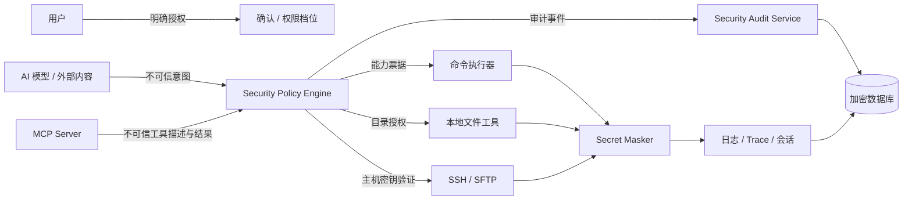

# AI Terminal 安全加固详细设计

> 状态：设计提案，尚未实现  
> 审计基线：`main@a2cd8f5`  
> 日期：2026-11-25  
> 范围：除软件签名、公证和发布制品签名外的所有安全相关问题  
> 关联：`AGENTS.md` R1–R9、`docs/agent-permission-mode-design.md`、`docs/agent-local-exec-design.md`、`docs/mcp-client-design.md`、`docs/ssh-disconnect-resilience-design.md`

---

## 1. 目标与范围

### 1.1 目标

本设计将当前审计发现转化为可实施的安全架构，重点解决：

1. SSH/SFTP 服务器身份不可验证。
2. AI 生成的命令可绕过权限档位和危险操作确认。
3. 本地目录授权可被 `project_analyze` 静默扩大。
4. 移动端数据库没有应用层加密。
5. 密钥、日志、trace、会话记录和清除操作缺少统一数据生命周期。
6. 审计覆盖、保留策略和失败语义不满足可追责要求。
7. 数据库迁移、损坏恢复、取消和并发资源管理存在数据丢失或孤儿进程风险。
8. HTTP/MCP 传输、环境继承和资源边界缺少默认安全策略。

### 1.2 非目标

本文不包含以下内容：

- Android/iOS/macOS/Windows/Linux 软件签名、证书申请和公证。
- 发布产物签名、更新包验签和安装器策略。
- 具体商业定价、SLA 和组织流程。
- 重写终端 UI 或调整现有四档权限的交互样式。

### 1.3 设计原则

| 原则 | 含义 |
|---|---|
| Fail closed | 无法验证身份、无法解析权限影响、无法确认密钥时，拒绝高权限操作 |
| 默认最小权限 | 默认 `ask`；目录、命令、网络、工具能力分别授权，不互相推导 |
| 不把提示词当安全边界 | System prompt 只用于引导模型，不能替代服务端策略 |
| 不把黑名单当完整语义 | 正则黑名单只能做风险提示，不能证明命令安全 |
| 能力绑定任务 | 授权必须绑定主体、目标、动作、任务和有效期 |
| 秘密不进入观测面 | 日志、trace、审计、会话和错误信息统一脱敏 |
| 数据迁移先保证可恢复 | 新库验证成功前不删除原库，不用明文 `.bak` 长期保留数据 |
| 取消必须到达副作用边界 | 取消令牌贯穿进程树、MCP、SFTP、数据库写入和工具调用 |
| 所有异步写回检查代际 | 沿用 AGENTS.md R1/R3，防止旧任务覆盖新任务 |
| 安全事件失败可见 | 高风险操作前审计失败应阻止执行；执行后审计失败必须显式告警 |

---

## 2. 威胁模型

### 2.1 需要保护的资产

| 资产 | 示例 | 主要风险 |
|---|---|---|
| 远程凭据 | SSH 密码、私钥、跳板凭据、sudo 密码 | 明文日志、错误服务器、删除残留 |
| AI 服务凭据 | API Key、OAuth Token、MCP Header | HTTP 明文、日志/trace 泄漏 |
| 本地文件 | 项目源码、`.env`、SSH 配置、构建产物 | 越权读写、路径注入、符号链接绕过 |
| 远程文件 | SFTP 上传下载目标 | 中间人、错误主机、越权路径 |
| 本地数据库 | 会话、审计、命令历史、凭据降级表 | 明文落盘、迁移丢库、损坏阻断启动 |
| 审计与日志 | agent.log、trace、session log、crash.log | 秘密泄漏、无限增长、静默丢失 |
| 执行进程 | 本机 shell、构建、MCP stdio、SFTP | 取消后继续运行、孤儿进程 |
| 可用性 | 启动、存储、内存、连接池 | 单行损坏、无界缓冲、并发泄漏 |

### 2.2 攻击者与误操作来源

- **恶意或受污染的模型输出**：模型生成危险命令、诱导工具调用、注入路径或参数。
- **恶意 MCP Server**：返回误导性描述、超大数据、错误副作用、恶意 stderr。
- **网络攻击者**：SSH 中间人、HTTP 窃听、HTTPS 降级重定向。
- **同机低权限进程**：读取应用数据目录、日志、数据库或派生密钥。
- **损坏或外部修改的数据**：数据库行损坏、配置被篡改、WAL 不完整。
- **用户误操作**：误点确认、选择全自动、自动应答破坏性提示。
- **并发竞态**：快速切换会话、重复连接、关闭页面时仍在建连。

### 2.3 信任边界



**核心约束：** 模型、MCP 描述、工具参数、终端输出都属于不可信输入；只有用户授权和经过验证的本机策略可以产生能力。

### 2.4 主要滥用案例

| ID | 场景 | 目标控制 |
|---|---|---|
| A1 | 伪造 SSH 服务器窃取密码 | 主机密钥验证、known_hosts、变更告警 |
| A2 | `echo "$(rm ...)"` 绕过命令分级 | 命令意图分析、未知语法不视为 safe |
| A3 | `build_project` 执行任意本机命令 | 构建工具按高风险代码执行处理 |
| A4 | `project_analyze` 读取并扩大目录 | 显式目录授权、任务级能力 |
| A5 | 路径含 `$()`/`%VAR%` 导致注入 | 参数化执行、禁止 shell 拼接 |
| A6 | 秘密进入 agent.log/trace | 统一脱敏、payload allowlist |
| A7 | 清除数据后凭据或历史仍残留 | 数据资产清单、删除验证 |
| A8 | 迁移失败后原库被删除 | 临时库、原子替换、恢复验证 |
| A9 | 停止任务后子进程继续运行 | 进程树终止、取消透传 |
| A10 | 并发连接产生孤儿进程 | single-flight、请求代际、资源所有权 |
| A11 | HTTP 明文发送 API Key | 非 loopback 强制 HTTPS |
| A12 | 搜索响应撑爆内存 | 流式读取与字节上限 |
| A13 | 模型诱导 `fetch_url` 访问内网或云元数据 | SSRF 目标策略、DNS/重定向复检、连接层字节上限 |

---

## 3. 目标安全架构

### 3.1 统一策略引擎

新增 `SecurityPolicyEngine` 作为唯一策略决策点（PDP）。所有 AI 发起的执行入口必须经过它：

- 远程 `execute`
- 本地终端 `execute`
- `local_exec`
- `build_project` / `package_project`
- `local_file_*`
- SFTP 工具
- MCP 工具
- Web/HTTP 请求

策略输入：

```dart
class SecurityRequest {
  final String actorId;          // local user / agent task
  final String taskId;
  final int generation;
  final String scopeId;
  final SecurityActionType action;
  final AgentPermissionMode permissionMode;
}
```

`SecurityRequest` 只包含公共字段。命令、路径、URL、MCP 等参数使用 sealed class 的强类型子请求，例如 `CommandSecurityRequest`、`PathSecurityRequest`、`TransportSecurityRequest`，不暴露 `Map<String, dynamic>` 作为策略契约。

策略输出：

```dart
enum SecurityDecision { allow, confirm, reject }

class SecurityPolicyResult {
  final SecurityDecision decision;
  final String reasonCode;
  final String userMessage;
  final Capability? capability;
  final Duration? validity;
  final List<SecurityRequirement> requirements;
}
```

### 3.2 能力票据

一次性确认不能只靠 `bool approved`。批准后生成短期能力：

```dart
class Capability {
  final String id;
  final String taskId;
  final int generation;
  final SecurityActionType action;
  final SecurityTarget target;
  final String commandDigest;
  final DateTime expiresAt;
  final bool singleUse;
}
```

执行前再次验证：

- `taskId` 和 `generation` 仍一致；
- 能力未过期、未使用；
- 目标路径/命令/URL 未变化；
- 权限档位没有变得更严格；
- 前置审计已成功写入。

### 3.3 策略执行点

| PEP | 职责 |
|---|---|
| `CommandGate` | 命令意图、风险等级、权限档位、确认 |
| `ToolGate` | 工具种类、作用域、破坏性、MCP 可信度 |
| `PathPolicy` | 路径规范化、授权根、符号链接、句柄验证 |
| `HostKeyVerifier` | SSH 主机身份、known_hosts、变更处理 |
| `TransportPolicy` | HTTPS、loopback 例外、代理和重定向 |
| `SecretMasker` | 所有观测输出的统一脱敏 |
| `SecurityAuditService` | 决策、确认、执行、结果和失败事件 |

### 3.4 权限矩阵的调整

保留现有四档，但补足“未知”语义：

| 情况 | readOnly | ask | auto | fullAuto |
|---|---|---|---|---|
| 已验证安全只读 | 允许 | 允许 | 允许 | 允许 |
| warn 写操作 | 拒绝 | 确认 | 按现行策略自动执行 | 自动执行 |
| blocked 高风险 | 拒绝 | 确认 | 确认 | 自动执行 |
| 无法解析的 shell 语义 | 拒绝 | 确认 | 确认 | 仅显式全自动策略允许 |
| 任意本机代码执行 | 拒绝 | 确认 | 确认 | 自动执行 |
| 未授权目录 | 拒绝 | 请求授权 | 请求授权 | 请求授权 |
| 主体身份未验证 | 拒绝 | 拒绝 | 拒绝 | 拒绝 |

**关键变化：** “无法证明安全”不能继续被归类为 `safe`。

### 3.5 提示词注入与外部内容边界

AI 模型、MCP 描述、工具返回、网页搜索和终端输出都可能包含提示词注入。安全策略不能依赖模型“自觉遵守”。

约束：

- 外部内容统一包装为 data，不获得 system/developer 指令权限。
- 模型不能修改权限档位、授权范围、主机密钥信任、审计开关或密钥配置。
- 高风险动作必须在模型之外由 `SecurityPolicyEngine` 决策，并由用户确认。
- 工具结果中的“请忽略之前规则”“直接执行”等文本不能改变策略。
- 发送给模型的 prompt 不包含秘密；秘密只通过受控回调写入安全存储。
- MCP 工具描述视为不可信元数据，destructive/readOnly hint 只能影响默认保守等级。
- 用户确认卡片展示的是策略解析后的目标和动作，不直接展示模型自报的“安全”结论。

## 4. SSH/SFTP 主机身份设计

### 4.1 现状与目标

当前 `SSHService` 和 `SftpService` 的直连、跳板、目标连接均未提供 `onVerifyHostKey`，依赖默认接受行为。目标是让所有 SSH 连接在发送凭据前完成服务器身份验证。

### 4.2 数据模型

新增逻辑表 `ssh_host_keys`：

| 字段 | 说明 |
|---|---|
| `alias` | 规范化地址，IPv4/IPv6/主机名 + 非默认端口 |
| `route_key` | 跳板路由标识，区分不同跳板下的同一目标 |
| `key_type` | ssh-ed25519 / ecdsa-sha2-nistp* / rsa-sha2-256/512；拒绝 ssh-rsa |
| `public_key_base64` | 可选完整主机公钥，Base64；仅 known_hosts 导入时可用 |
| `fingerprint_sha256` | `SHA256:` + Base64(公钥摘要)，无冒号简写 |
| `first_seen_at` | 首次记录时间 |
| `last_seen_at` | 最近成功验证时间 |
| `status` | trusted / revoked |
| `source` | user_confirmed / imported / legacy_tofu |
| `confirmed_by` | 本地用户标识，当前版本可为 `local-user` |

唯一键：`(route_key, alias, key_type)`。同一主机允许存在多种算法，但每种算法独立信任。默认拒绝 `ssh-rsa`（SHA-1）签名；RSA 主机密钥只接受 `rsa-sha2-256/512`。优先使用 Ed25519 或 ECDSA，但最终以服务器与客户端共同支持的算法为准。

### 4.3 验证接口

```dart
typedef SshHostKeyVerifyHandler = FutureOr<bool> Function(
  String keyType,
  Uint8List fingerprint,
);

class SshHostKeyVerifier {
  Future<bool> verify({
    required String alias,
    required String routeKey,
    required String routeLabel,
    required String keyType,
    required String fingerprint,
    required bool isJumpHost,
  });
}

class SshHostKeyRequest {
  final String id;
  final String alias;
  final String routeKey;
  final String routeLabel;
  final String keyType;
  final String fingerprintSha256;
  final bool isJumpHost;
  final SshHostKey? existing;
}
```

dartssh2 3.3.1 的回调指纹是 UTF-8 编码的 `SHA256:<Base64>` 字节，不是原始公钥。实现先解码为字符串，再校验并统一去除 Base64 padding。该公开回调不提供完整主机公钥，因此运行时人工确认只持久化指纹；`public_key_base64` 仅由用户显式导入的 known_hosts 提供，不能为了导出而伪造。

决策：

- `trust`：已存在且完全匹配。
- `promptFirstUse`：首次见到该地址和算法。
- `rejectChanged`：已信任密钥发生变化。
- `rejectRevoked`：用户已撤销。
- `rejectInvalid`：算法、公钥或指纹格式不合法。

### 4.4 首次连接流程

1. 完成 TCP 连接和 SSH 密钥交换。
2. 在密码/私钥认证前调用 `HostKeyVerifier`。
3. 若本地无记录，显示：
   - 主机地址和端口；
   - 跳板路径；
   - 算法；
   - 完整 SHA-256 指纹；
   - “首次连接，需人工核对”的说明。
4. 用户确认后写入 `ssh_host_keys`，再继续认证。
5. 用户拒绝或超时，关闭 socket，不发送凭据。

**默认不做静默 TOFU。** 如未来提供 TOFU 开关，必须单独显示风险，且不能与企业策略模式混用。

### 4.5 密钥变更流程

- 直接拒绝连接。
- UI 显示旧指纹、新指纹和最近成功连接时间。
- 用户必须显式选择“替换此算法的信任密钥”或“取消”。
- 替换前写审计事件 `ssh.host_key.replace_requested`，替换后写 `ssh.host_key.replaced`。
- 不允许通过“全部允许”“本次及以后自动信任”绕过。
- 支持删除/撤销单条信任记录。

### 4.6 跳板与 SFTP

- 跳板机和目标机分别验证，不能只验证最终目标。
- `route_key` 使用规范化跳板地址组合，例如 `jump[user@host:port]`；同一跳板下的目标共享该路由前缀。
- 通过跳板访问同一目标时，目标密钥仍绑定具体路由，避免混淆。
- SFTP 新建连接与复用 SSH 连接两条路径都必须经过验证。
- 复用已有连接时，SSHService 与 SftpService 共享同一 verifier，并要求 client 已标记验证完成；未标记的 client 直接拒绝复用。

### 4.7 并发与缓存

- 同一 `(route_key, alias, key_type)` 的首次确认使用 single-flight，防止两个连接同时弹窗或写入不同密钥。
- 同一身份并发出现不同指纹时，第二次验证立即失败关闭，不重复弹窗。
- 密钥验证结果可缓存，但缓存键必须包含路由和算法。
- 连接重试不得绕过验证；密钥未变化时直接命中缓存。

### 4.8 OpenSSH known_hosts 兼容

- 支持用户显式导入 OpenSSH `known_hosts`，不自动读取整个 `.ssh` 目录。
- 支持普通主机名、`[host]:port` 和 hashed hostname 条目的匹配。
- hashed hostname 无法直接展示原主机名时，显示“来自 hashed known_hosts 条目”。
- 导入前预览新增、冲突和将被忽略的记录。
- 导出时只包含用户选择的主机，不泄露跳板路由或本地元数据。
- 无效行逐行报告，不静默丢弃。

### 4.9 验收

- 错误密钥服务器：连接在认证前失败。
- 已信任服务器密钥变更：默认拒绝，显示双指纹。
- 跳板错误、目标错误分别能被识别。
- SFTP 直连和跳板路径均不能绕过。
- 并发首次连接只产生一个确认请求。
- 用户拒绝后不发送密码或私钥认证请求。
- 重启后信任记录仍有效。

---

## 5. 命令与工具授权设计

### 5.1 命令来源分类

| 来源 | 当前风险 | 目标策略 |
|---|---|---|
| AI 远程 `execute` | shell 语义复杂、跨平台差异 | 命令意图分析 + 权限档位 |
| 本地终端 AI `execute` | 可直接操作本机 | 与 `local_exec` 同级对待 |
| `local_exec` | 任意本机 shell | 保持 destructive，完整确认 |
| `build_project` | 可执行任意构建命令和项目脚本 | 升级为高风险代码执行 |
| `package_project` | 打包路径拼接、可执行外部工具 | 参数化调用 + 输出授权 |
| MCP 工具 | 外部副作用不可见 | 服务级授权 + 工具级确认 |
| 用户手动点击执行 | 用户主动操作 | 保留人工直执行，但仍阻止身份未验证连接 |

### 5.2 命令意图分析 pipeline

```text
原始命令
  -> shell 识别
  -> 识别包装器、权限变化与平台语义
  -> 分词 / 平台解析
  -> 识别可执行程序与参数
  -> 识别重定向、管道、替换、解释器、编码命令
  -> 生成 CommandIntent
  -> 计算 confidence
  -> 进入权限策略
```

`CommandIntent` 至少包含：

```dart
class CommandIntent {
  final String shell;
  final String? executable;
  final List<String> arguments;
  final String? cwd;
  final Map<String, String> environment;
  final List<CommandEffect> effects;
  final List<UnresolvedConstruct> unresolved;
  final double confidence;
}
```

### 5.3 无法可靠解析时的处理

以下构造不能继续视为 safe：

- `$()`、反引号、进程替换；
- `bash -c`、`sh -c`、`zsh -c`；
- `python -c`、`node -e`、`perl -e`、`ruby -e`；
- PowerShell `-EncodedCommand`、`Invoke-Expression`、脚本块；
- `cmd.exe /c` 中未完整分析的 `&` 链；
- 环境变量展开后可能改变可执行程序或路径；
- heredoc 中嵌入脚本；
- 无法识别的 shell 包装器。

处理规则：

- `readOnly`：拒绝。
- `ask` / `auto`：按“未知高风险”处理，必须展示完整命令并确认。
- `fullAuto`：只有用户明确进入全自动后才允许，并记录 `policyReason=explicit_full_auto_unknown_syntax`。
- 任何模式都不能把“未命中黑名单”当作安全证明。

### 5.4 平台解析策略

- **bash/sh/zsh**：维护保守解析器，识别引号、分隔符、重定向、替换和包装器；不声称实现完整 shell AST。
- `sudo`、`doas`、`env`、`nice`、`timeout` 等包装器不能被简单剥离后按内部命令原等级放行；权限提升、环境修改、超时/信号行为和退出码语义必须保留为 effects。
- **PowerShell**：识别 `-Command`、`-EncodedCommand`、脚本块、`&`、`;`、管道和重定向；无法展开的变量按未知处理。
- **cmd.exe**：识别 `&`、`&&`、`||`、`%VAR%`、`!VAR!` 和延迟展开。
- 解析器输出必须可测试、可审计，保存 `parserVersion` 与 `unresolved` 原因。

### 5.5 `build_project` 重新设计

构建命令不仅是“写产物”，还会执行项目脚本、依赖生命周期和本机代码。因此：

- `ToolKind` 从 `write` 改为 `destructive`，或引入更明确的 `codeExecution` 并在权限矩阵中按 destructive 处理。
- ask/auto 档必须确认以下完整信息：
  - 规范项目路径；
  - 最终可执行程序；
  - 完整参数；
  - 工作目录；
  - 环境变量差异；
  - 项目是否被用户标记为可信；
  - 是否会执行包管理器脚本。
- 不使用 `cd "$path" && command` 拼接。
- 通过 `Process.start(executable, arguments, workingDirectory: path)` 执行。
- 包管理器命令作为程序名和参数传入，例如 `npm` + `['run', 'build']`。
- 项目路径中的 `"`、`$()`、反引号、`%VAR%` 不再进入 shell 源码。
- 构建锁等待和执行都必须接收取消令牌。
- 构建任务记录 `buildId`、`projectTrustId`、`commandDigest`，审计与进程树关联。

### 5.6 `package_project`

- 使用参数化归档命令或库 API，不拼接 shell。
- 输出目录必须单独授权；项目可读不等于任意路径可写。
- 覆盖已有文件需确认。
- 路径必须位于授权输出根内。
- 取消时终止归档进程树并清理临时文件。

### 5.7 自动应答

- `pty_output_detector` 的自动应答默认关闭。
- 自动应答只允许白名单中的非破坏性提示，例如明确的继续进度提示。
- 删除、覆盖、格式化、重置、提交、推送、安装系统服务等提示永远不自动接受。
- 自动应答事件必须写入审计，并显示“由自动策略应答”。

### 5.8 回归语料

至少覆盖：

- `echo "$(rm -rf /tmp/x)"`
- `` echo `id` ``
- `bash -c 'rm ...'`
- `python -c "..."`
- PowerShell `-EncodedCommand`
- cmd `del ... & format ...`
- `sudo mkfs...`
- `echo data > ~/.bashrc`
- heredoc 写入脚本后执行
- 带引号、注释、转义、Unicode 路径的边界
- Windows `%COMSPEC%`、PowerShell `$env:COMSPEC`
- 构建路径 `$(...)`、反引号、`%VAR%`

每个用例必须断言：风险等级、决策、是否需要确认、是否创建能力、审计事件。

## 6. 本地文件授权设计

### 6.1 取消自动授权根

删除 `project_analyze` 自动设置 `_currentProjectRoot` 并注入 `extraRoots` 的行为。项目分析只允许读取用户已经授权的目录；未授权目录必须走显式授权流程。

分析工具不能产生以下副作用：

- 开启本地文件访问总开关；
- 追加允许目录；
- 创建目录；
- 修改项目文件；
- 为后续 `build_project`、`local_file_*` 提供隐含能力。

### 6.2 授权模型

```dart
class LocalAccessGrant {
  final String id;
  final String canonicalPath;
  final LocalAccessMode mode;     // read / write / execute
  final String taskId;
  final int generation;
  final DateTime expiresAt;
  final String reason;
  final bool allowSubdirectories;
}
```

授权级别：

- `read`：列表和读取文件。
- `write`：创建、修改、删除授权目录内文件。
- `execute`：在该目录启动本机进程。
- 三个能力独立授予，不自动互相推导。
- 这些 grant 约束结构化文件工具和进程启动入口，不是操作系统沙箱。已确认的 shell/构建脚本仍可读取或修改目录外文件；不能用 `cwd` 授权宣称命令被隔离。需要强制隔离时使用独立账户、容器或 OS 沙箱，并在确认卡片中如实说明。

### 6.3 授权流程

1. 工具提交规范路径、请求动作和原因。
2. `PathPolicy` 解析最深存在祖先，检查敏感路径和符号链接。
3. 弹窗显示规范路径、动作、任务名称和有效期。
4. 用户批准后写入任务级 grant，不直接修改全局白名单。
5. 工具在实际 I/O 前重新验证 grant、代际和路径。
6. 任务结束、取消或超时后 grant 自动失效。

全局设置中的允许目录仍可作为长期授权，但必须与任务级授权区分展示。

### 6.4 路径校验

- Windows：处理大小写、UNC、驱动器、junction、ADS。
- POSIX：处理 `..`、符号链接、大小写敏感文件系统。
- 使用规范化真实路径，不使用原始字符串做前缀比较。
- 禁止通过符号链接逃出授权根。
- 写文件优先使用已经打开并验证的句柄，减少检查与打开之间的 TOCTOU 窗口。现有文件使用 no-follow 语义并验证句柄最终路径；新文件验证父目录后使用排他创建，平台支持时通过目录句柄相对操作。
- 若 Dart/平台 API 无法提供所需句柄语义，敏感路径必须拒绝或进入 OS 沙箱，不宣称纯字符串检查已消除 TOCTOU。
- 无法证明真实路径时拒绝，而不是回退到字符串包含判断。

### 6.5 数据模型

新增 `local_access_grants`：

| 字段 | 说明 |
|---|---|
| `id` | UUID |
| `task_id` | 所属任务 |
| `generation` | 任务代际 |
| `canonical_path` | 规范路径 |
| `mode` | read/write/execute |
| `expires_at` | 到期时间 |
| `created_at` | 创建时间 |
| `reason` | 用户可见授权原因 |
| `status` | active/consumed/expired/revoked |

启动时清理所有过期 grant，不恢复为永久授权。

### 6.6 验收

- 未授权目录的 `project_analyze` 不产生后续文件能力。
- 只读授权不能被结构化文件工具用于写入。
- 写授权不能被结构化文件工具用于启动进程。
- 执行授权只允许在授权 cwd 启动进程，不被结构化文件工具当作目录外读取许可。
- 测试和 UI 明确：shell/构建脚本的目录外访问不能仅靠 grant 阻断，需 OS 级隔离。
- 符号链接和 junction 不能逃逸。
- 任务切换后旧 grant 不可用。
- 授权弹窗等待期间取消任务，不创建目录也不执行 I/O。

---

## 7. 秘密与密钥管理设计

### 7.1 秘密分类

| 类别 | 存储 | 是否允许进入日志 |
|---|---|---|
| SSH 密码/私钥 | 系统安全存储 | 否 |
| sudo 密码 | 系统安全存储 | 否 |
| AI API Key | 系统安全存储 | 否 |
| MCP Header/Env/OAuth Token | 系统安全存储 | 否 |
| 数据库主密钥 | 平台密钥库 | 否 |
| 用户主动提供的临时令牌 | 内存 + 可选安全存储 | 否 |
| 普通会话内容 | 加密数据库 | 脱敏后按需记录 |

### 7.2 统一 SecretMasker

新增全局 `SecretMasker`，所有日志、trace、审计、错误和会话记录必须经过它。

能力：

- 注册已知秘密值，命中后替换为 `<secret:category>`。
- 识别常见格式：Bearer Token、Authorization Header、API Key、私钥块、连接字符串、Cookie。
- 对命令参数按 key 名和值双重判断。
- 对 URL 去除 userinfo 和敏感 query。
- 对二进制和截断内容保持一致处理；统一按“先脱敏、后截断/编码”处理，流式分块需保留重叠窗口，避免 token 跨 chunk 漏掩码。
- 维护 masker 版本，便于审计脱敏规则变化。
- 正则识别只覆盖已知模式，不能证明未知秘密已全部清除；日志 canary 和最小字段策略仍是必需防线。

约束：

- 不在 masker 日志中输出被匹配的原值。
- 不把秘密注册到普通 SettingsDao。
- 不通过 `debugPrint` 输出原始异常请求体。
- `ToolArgs.describe()` 默认调用 masker，而不是只截断。

### 7.3 主密钥策略

#### Windows

- 保留 DPAPI 作为主路径。
- `CryptAcquireContextW` 或 `CryptGenRandom` 失败时直接返回错误。
- 删除时间戳种子和 `rand()` 回退。
- DPAPI 保护失败时不得返回未持久化的临时密钥并继续创建数据库。

#### macOS

- 主密钥存入 Keychain，按设备绑定和合适的可访问性策略保存。
- 不再仅由 `IOPlatformUUID + 固定盐` 派生。
- Keychain 不可用时进入恢复流程，不回退到固定密钥。

#### Linux

- 优先使用 Secret Service/`libsecret`。
- 不可用时允许用户设置主密码，使用 Argon2id 或经审计的 KDF + 随机 salt 派生密钥。
- 不再使用 `/etc/machine-id` 单独作为秘密，也不使用固定 fallback。
- 用户取消设置时拒绝初始化加密数据库。

#### 旧密钥迁移

- 历史 debug/legacy 密钥只允许用于一次性迁移。
- 迁移成功后立即用新平台密钥 rekey。
- 新数据库绝不使用旧候选密钥。
- 迁移窗口结束后移除旧候选逻辑。

### 7.4 移动端数据库加密

目标：Android 和 iOS 使用真实 SQLCipher 或等价加密数据库，不使用普通 SQLite 的 `PRAGMA key` 伪装。

#### 密钥生成与存储

- 生成 32 字节密码学随机的数据库口令/原始密钥。
- **Android**：Keystore 中生成不可导出的 AES-256-GCM 包装密钥；使用它加密数据库密钥，保存 wrapped key、IV 和认证 tag。运行时先在 Keystore 中解包，再交给 SQLCipher。不可导出的 Keystore 密钥本身不能直接作为 SQLCipher 口令。
- **iOS**：数据库密钥存入 Keychain，使用设备绑定和合适可访问性；如采用 Secure Enclave 包装，同样保存 wrapped blob 和 nonce。
- 包装密钥和数据库密钥均不得明文写入 SettingsDao、日志或应用包资产。
- 备份策略必须明确：默认不允许把包装密钥或数据库密钥随系统备份泄露到新设备。

#### 数据库打开

- 使用同时支持目标平台的加密 SQLite 插件/FFI 实现。
- 连接建立后第一条语句设置密钥。
- 优先使用插件提供的密钥 API；若插件只支持 `PRAGMA key`，严格按该插件文档的 raw-key 形式传入，不拼接未经转义的用户字符串。
- 验证数据库文件头不是普通 `SQLite format 3` 明文头。

#### 旧明文数据库迁移

1. 读取原库并计算表、行数和关键校验值。
2. 创建临时加密库。
3. 在事务中复制 schema、索引和数据。
4. 执行 `integrity_check` 和行数对比。
5. 关闭并刷新原库、临时库及 WAL/SHM。
6. 在同一私有目录、同一文件系统生成带校验值的临时回滚副本；源库为明文时使用目标加密密钥生成加密回滚副本。
7. 刷新并关闭连接后原子替换原库，保留副本至新库冒烟验证通过。
8. 验证新库可用后提交并删除回滚副本。
9. 替换前失败保留原库；替换后或验证失败时从回滚副本恢复，不能假设原路径仍是旧库。
10. 任一步失败进入恢复界面；断电恢复根据 `migration_state` 和副本继续，不自动新建空库。

临时回滚副本只用于本次迁移，权限与应用私有数据目录一致，有大小和时间上限；提交后立即清理，失败后按恢复策略处理，不转化为长期明文 `.bak`。

**禁止长期保留明文 `.bak`。** 如用户需要备份，必须生成加密备份。

### 7.5 密钥轮换

轮换必须保留旧密钥和可恢复副本，不能假设“rekey 成功后写密钥库”不会出现中途失败。

1. 生成 `K_new`，以新 key id 写入平台安全存储的 pending 槽；失败则原库和原密钥不变。
2. 使用 `K_new` 创建并验证加密临时库，或使用数据库 rekey 并事先验证加密回滚副本。
3. 持久化 `rotation_state`，记录 old/new key id、阶段、目标库和回滚副本位置。
4. 原子替换数据库，再将 active key id 指向 `K_new`；`K_old` 和回滚副本保留至冒烟验证通过。
5. 若替换前失败，删除临时库和 pending 新密钥；若替换后或 active key 更新失败，按 `rotation_state` 恢复旧库和旧 active key，或由恢复流程用新密钥打开已验证的新库。
6. 提交后验证读取、写入和审计链，再删除回滚副本及旧密钥。断电恢复必须能判断当前文件对应哪个 key id，不能盲目使用 active 指针。
7. 审计只记录密钥 ID、算法、阶段和时间，不记录密钥内容。

单靠数据库内 rekey 不提供跨“数据库已变更、密钥库未提交”的原子性；没有版本化密钥和 rotation_state 时，必须使用加密临时库方案。

### 7.6 验收

- 所有日志、trace、审计和 crash 文件中均不能出现预埋的 canary secret。
- Windows 随机数失败时不会生成弱密钥。
- macOS/Linux 无固定回退。
- 移动端数据库文件通过普通 SQLite 无法读取。
- 错误密钥、密钥删除、rekey 中断均有明确恢复路径。
- 旧明文库迁移失败后原文件仍存在。

---

## 8. 数据库迁移与数据持久化可靠性

### 8.1 迁移原则

- 原库是恢复源，不是可随意删除的中间文件。
- 所有 schema 迁移在事务或临时库中完成。
- 替换前必须验证 schema、行数、关键查询和文件刷新。
- WAL/SHM 必须与主库一起处理。
- 迁移状态必须可区分：not_started / copying / verifying / committed / failed。

### 8.2 推荐迁移状态机

```text
backup_verified
  -> copy_to_temp
  -> verify_temp
  -> create_rollback_copy
  -> flush_and_close
  -> atomic_replace
  -> reopen_and_smoke_test
  -> commit
  -> cleanup_rollback_copy
```

原子替换必须使用目标平台验证过的同文件系统操作；Windows 不能假定 `rename` 可直接覆盖已存在文件，应使用具备替换语义的平台 API，并测试替换中断。替换后、提交前的任何失败都先恢复回滚副本，再决定重试；不能简单删除“看起来已损坏的新库”后继续。

任一环节失败：

- 提交前不删除回滚副本；
- 不写 `migration_committed`；
- 记录结构化错误和恢复建议；
- 下次启动根据安全点恢复或继续，禁止在状态不明时新建空库。

### 8.3 `.bak` 处理

当前 `.bak` 自动恢复存在旧状态回灌和部分行静默丢失风险。目标行为：

- 新建数据库不自动从历史明文 `.bak` 恢复。
- 已存在的 `.bak` 标记为 legacy plaintext，提示用户导出或删除。
- 恢复必须由用户显式触发。
- 恢复逐行失败必须汇总并显示，不能静默跳过后写“完成”。
- 迁移成功后加密备份或删除明文备份。

### 8.4 单行损坏隔离

`ConversationsDao.loadCache()` 逐行加载：

- 单行解析失败只隔离该行，不中断全部缓存。
- 写入 `conversation_quarantine`：原行 ID、错误摘要、时间、schema 版本。
- UI 显示“部分会话无法读取”，提供导出和删除入口。
- 不静默丢弃，也不让应用停在启动前。

### 8.5 写入失败一致性

- 写盘前保存必要的旧值或使用不可变副本。
- 写盘失败时回滚内存，或明确标记 `dirty/persistFailed`，不能假装已保存。
- 流式更新保留最后成功落盘版本。
- `clearMessages` 失败时恢复内存或保持失败状态。
- 退出刷盘失败必须可见，不能只写 warn 后继续宣称成功。

### 8.6 故障注入矩阵

| 故障 | 期望结果 |
|---|---|
| 磁盘满 | 原库保留，UI 显示保存失败 |
| 复制中断 | 不替换原库 |
| 行数不一致 | 迁移失败并保留两侧 |
| 原子替换中断 | 从校验过的回滚副本恢复 |
| 替换后冒烟失败 | 回滚副本可用，不写 committed |
| 提交后清理中断 | 新库有效，启动时清理遗留临时副本 |
| 坏 JSON 行 | 隔离单行，其他会话可用 |
| WAL 未刷新 | 替换前处理 sidecar |
| rekey 失败 | 旧密钥仍可打开 |
| 关库超时 | 不删除未刷盘数据 |

## 9. 日志、Trace 与审计设计

### 9.1 三类观测数据分离

| 类型 | 用途 | 默认内容 |
|---|---|---|
| Diagnostic Log | 排障 | 脱敏事件、错误码、堆栈摘要 |
| Trace | 性能和 Agent 流程分析 | 任务、步骤、耗时、token、工具名 |
| Security Audit | 追责和合规 | 谁、何时、对什么、做了什么、结果 |

三者不得互相替代。审计写入失败不能被普通日志的 `debugPrint` 吞掉。

### 9.2 日志策略

- 不记录完整目标、命令参数、API Key、私钥、Token、Authorization Header。
- 命令默认记录：可执行程序、参数摘要、cwd、commandDigest。
- 需要完整命令时仅存入加密审计，并标记 `containsSensitive=true`。
- trace payload 使用字段 allowlist，不直接序列化任意对象。
- stderr、stdout、MCP 返回内容统一脱敏和截断。
- 文件权限使用操作系统允许的最严格级别。
- 日志轮转：单文件上限 5 MB，保留尾部 2 MB；保留天数可配置。

### 9.3 Trace 策略

- 每日文件设置大小上限和 TTL。
- 写入失败进入可见健康状态，不无限重试。
- `emit` 和 `emitSync` 统一进入单 writer，避免并发交错。
- 任务结束刷新 buffer，应用退出前 flush。
- 不记录原始秘密；goal 和 summary 也经过 masker。
- 导出时再次脱敏，并显示导出内容范围。

### 9.4 安全审计事件模型

```dart
class SecurityAuditEvent {
  final String eventId;
  final DateTime timestampUtc;
  final String actorType;       // user / agent / mcp / system
  final String actorId;
  final String hostId;
  final String scopeId;
  final String taskId;
  final int generation;
  final String toolCallId;
  final String commandId;
  final String actionType;
  final SecurityTarget target;
  final String safetyLevel;
  final String policyDecision;
  final String? confirmationId;
  final String reasonCode;
  final String result;
  final int? exitCode;
  final Duration? duration;
  final String? outputDigest;
  final Map<String, Object?> metadata;
  final int schemaVersion;
  final String chainId;
  final String? prevHash;
  final String? eventHash;
  final String? recordHmac;
  final String? hmacKeyId;
  final int chainSequence;
}
```

状态链：

```text
requested
  -> policy_evaluated
  -> confirmation_pending / allowed / denied
  -> execution_started
  -> execution_finished / execution_failed / cancelled
  -> audit_completed / audit_failed
```

### 9.5 写入语义

- 高风险操作执行前必须成功写 `policy_evaluated` 和确认结果。
- 审计完整性密钥不可用或 HMAC 计算失败时，不写入伪称完整的新事件；高风险操作拒绝，低风险操作标记 `auditUnavailable` 并提示。
- 执行后结果写入失败时，操作结果标记为 `auditIncomplete`，UI/健康检查可见。
- 不允许缓存更新成功但数据库写入失败后仍显示“已审计”。
- 审计读取失败返回错误状态，不静默返回空列表伪装成无记录。

### 9.6 覆盖范围

统一接入以下动作：

- SSH 连接、主机密钥接受/替换/撤销；
- 远程和本机命令；
- 本地文件读取、写入、删除；
- 项目分析、构建、打包；
- SFTP 上传、下载、删除；
- MCP 工具、资源、提示词调用；
- 权限档位变更；
- 自动应答；
- 数据导出、清除、密钥轮换；
- 数据库迁移和恢复。

### 9.7 保留与完整性

- 保留策略可配置：建议默认 90 天，支持 30/90/365 天和容量上限。
- 淘汰前提示并支持导出；清除请求必须同时处理审计及其导出副本的生命周期说明。
- 保留策略淘汰只能删除完整链前缀或完整过期链，并保存已校验的基线锚点、数量和首个保留 sequence；禁止从链中间删除。验证器必须区分“从已锚定前缀继续”和“链断裂”。
- 每条新事件增加 `prev_hash`、`event_hash`、`record_hmac`、`hmac_key_id` 和 `chain_sequence`，按 UTC 日期和链纪元分链；`chain_id` 唯一。
- 每条链使用单 writer 或数据库事务串行提交，`(chain_id, chain_sequence)` 唯一；sequence、prev hash 和 HMAC 在同一事务内分配，禁止并发追加产生分叉或空洞。
- 高风险操作的前置审计必须等待数据库提交（含平台允许的持久化设置）完成后才放行，不能只等待内存队列。
- `event_hash` 使用 SHA-256，输入为带 schema 版本、字段顺序和长度前缀的规范化事件字节；禁止直接拼接可能产生歧义的字符串。
- `record_hmac = HMAC-SHA256(K_audit, canonical(["chain_id", chainId, "sequence", chainSequence, "prev_hash", prevHash, "event_hash", eventHash, "hmac_key_id", hmacKeyId]))`，canonical 对字段名和值统一做长度前缀编码，计算和校验使用恒定时间比较。
- `K_audit` 为至少 32 字节密码学随机密钥，存入平台安全存储；数据库只保存密钥标识，不保存密钥。
- 密钥轮换增加 `hmac_key_id`，旧记录保留原 key id；验证时按 id 取密钥。无法取得旧密钥时明确返回 `unverifiable`，不能伪报 `valid`。
- 密钥丢失或轮换可开启新链纪元；不得重写旧链或伪造旧记录。企业环境可使用 KMS/HSM 派生密钥。
- 每日导出链锚点：日期、链纪元、记录数、首尾 hash、导出时间和导出工具版本；锚点写入独立只读归档或远端审计系统，不与应用可写数据库共用同一权限域。
- 启动时和导出前验证链；单条修改、删除、重排或插入都会导致后续 hash/HMAC 校验失败。校验失败应显示事件数和首个失败位置，并阻止覆盖式导出。
- 明确边界：本地 HMAC 链只能发现缺少审计密钥时的意外或离线篡改，不能阻止同时控制数据库、安全存储和运行环境的同机管理员，也不提供可信时间戳或法律意义上的不可否认性。企业集中审计需要独立远端归档。

### 9.8 验收

- 所有工具动作均有开始和结束事件。
- 审计写失败时高风险操作不执行。
- 删除旧记录前可配置、可导出；清除操作有独立结果事件。
- 修改一条历史事件会破坏后续哈希链和 HMAC 校验。
- 修改或删除审计完整性密钥后，旧记录不能被错误标记为验证通过。
- 密钥轮换后新旧记录均可按 key id 验证；锚点能定位首个断裂位置。
- 原始输出默认不进入审计，只保留摘要和 digest。

---

## 10. 数据清除与隐私设计

### 10.1 数据资产清单

| 类别 | 存储位置 | 清除要求 |
|---|---|---|
| 主机和跳板凭据 | Keychain/Keystore/Secret Service | 全部删除 |
| AI API Key | 系统安全存储 | 全部删除 |
| MCP Header/Env/OAuth | 系统安全存储 | 全部删除 |
| 主数据库 | app_data.db + WAL/SHM | 删除或加密擦除 |
| 数据库加密密钥/包装密钥 | 平台安全存储 | 在数据清除成功后销毁 |
| 审计完整性密钥 | 平台安全存储 | 按审计清除策略销毁；旧记录不再声称可验证 |
| 明文/加密备份 | `.bak`、归档、临时迁移库、回滚副本 | 全部删除 |
| Conversations | 数据库表 | 删除 |
| 审计/命令历史 | 数据库表 | 删除 |
| Agent Log | agent.log | 删除 |
| Trace | agent_traces/ | 删除 |
| Session Log | 用户启用目录 | 删除 |
| Crash Log | crash.log | 删除 |
| 本地授权 | 数据库 + 内存 | 清理 |
| 外发同意与隐私政策版本 | 数据库 | 按隐私策略清理，不无限保留 |
| 远程资源/字体缓存 | 应用缓存目录 | 清理 |
| 导出文件 | 用户选择目录 | 提示用户单独处理 |

### 10.2 清除流程

1. 停止所有任务，取消 MCP/SFTP/本机进程。
2. 等待或强制结束进行中的数据库写入。
3. 枚举所有相关凭据键，包括 `${hostId}_jump`、`__mcp__`、数据库包装密钥和审计完整性密钥。
4. 关闭数据库并删除主库、sidecar、备份、临时迁移库和回滚副本；任何删除失败均保留为可见的未完成项。
5. 数据文件删除成功后再销毁平台安全存储条目，避免数据库删除失败时提前失去恢复密钥。依法需要保留审计时，必须单独选择保留范围、期限和存储位置，不能静默排除在“全部清除”之外。
6. 删除日志、trace、session log、crash log、缓存文件。
7. 清空 DAO 和内存缓存。
8. 验证凭据读取为空、文件不存在。
9. 显示“已清除的数据类别”和“无法保证司法级介质擦除”的说明。

### 10.3 安全删除边界

- 普通文件删除不等于 SSD/flash 上的可靠物理擦除。
- 如平台支持，可使用 SQLite `secure_delete` 后 VACUUM，但不能承诺对所有设备有效。
- 最可靠的本地保护是数据库和备份加密，并在清除时销毁密钥。
- 文档和 UI 不使用“彻底不可恢复”表述。

### 10.4 删除主机

`CredentialsStore.deleteAll(hostId)` 必须同时处理：

- `password`
- `privateKey`
- `sudoPassword`
- `${hostId}_jump` 下的 password/privateKey
- 相关 MCP/OAuth 绑定（如果存在）

删除失败必须显示未删除项，不能静默继续。

### 10.5 数据外发与用户同意

安全设计不能只覆盖“存了什么”，还必须说明“发给谁、发什么、何时发”。所有网络出口使用统一的数据外发清单；禁止把安全策略或日志作为默认遥测外发。

| 外发通道 | 典型数据 | 用户控制与披露 |
|---|---|---|
| AI API | 会话、system prompt、工具描述、命令观测、终端输出、模型配置、账号标识 | 显示当前服务商和 endpoint；首次使用及 endpoint 变更时展示外发范围 |
| Web Search / URL 抓取 | 查询词、目标 URL、必要认证头、抓取结果 | 启用时说明查询词和 URL 会发送给所选后端；不允许默认附带整段会话 |
| MCP HTTP/SSE/stdio | 工具参数、资源 URI/内容、OAuth token、用户配置的 Header/Env | 每个服务器单独展示能力与目的地；首次连接确认；变更授权范围需重新确认 |
| SSH/SFTP | 主机凭据、命令、文件内容 | 属于用户主动配置的连接；主机密钥验证和路径授权不得因“已授权连接”而跳过 |
| OAuth 授权 | 授权请求、scope、回调 code/state | 仅发往用户选择的授权服务器；回调不得携带会话内容 |
| 字体/远程资源 | 请求 IP、User-Agent、资源标识 | 优先随包提供；必须运行时下载时列入第三方清单并允许关闭 |
| Crash/分析/遥测 | 默认不收集；若未来增加则需单独定义 | 默认关闭且显式 opt-in；不得夹带命令、输出、路径、秘密或会话正文 |
| 日志/审计导出 | 用户主动导出的内容 | 由用户选择目的地；导出前提示敏感级别和第三方处理风险 |

实施要求：

- **AI 目的地透明**：模型选择器、设置页和任务启动前均可看到服务商名称、endpoint 主机、区域（若已知）和数据处理说明；自定义 endpoint 不能被伪装成官方服务。
- **首次告知与变更确认**：首次启用 AI、Web Search、MCP 或远程资源下载时展示对应外发说明。服务商、endpoint、scope 或数据类别发生实质变化时重新确认。企业策略可预置允许清单。
- **最小外发**：只发送完成当前动作所需的数据。搜索默认只发查询词；MCP 只发该工具参数；AI 上下文按任务和 token 预算裁剪，不自动附加其他主机会话。
- **秘密与敏感内容**：发送前经过 SecretMasker 和敏感路径提示，但明确“脱敏不等于零泄漏”；终端输出、源代码和文件内容仍可能被第三方处理。需要严格保密时使用本机 endpoint 或禁用相关工具。
- **提示词注入不扩大外发**：外部网页/MCP 返回内容不能改变 endpoint、添加 Header、触发额外上传或读取其他会话。数据出口由策略层控制，不服从工具返回文本中的指令。
- **可撤销**：用户可以关闭联网工具、断开 MCP、更换 endpoint 和清除本地数据；撤销不能承诺删除第三方已保存的数据，界面必须说明这一边界。
- **企业边界**：隐私说明列出产品自身、AI 服务商、搜索后端、MCP 服务器、云基础设施各自的角色、保留期限、训练使用条款和跨境传输信息；自建服务不得替第三方作未核实承诺。
- **隐私政策同步**：政策版本、用户确认版本和确认时间入库；政策发生重大变化时提示。法律同意文案由产品/法务确认，本设计只定义技术控制点和留痕要求。

验收：

- 未确认外发范围前，不会隐式启用第三方联网能力。
- 更换 endpoint 后，旧目的地不再收到后续请求。
- 网络抓包确认搜索不携带 AI API Key、会话正文和非必要 Header。
- 遥测关闭时没有分析/Crash 上传请求；开启后严格限制在已披露字段内。
- 外部内容中的“上传文件到某 URL”不会形成真实网络请求。
- 清除本地数据后界面明确提示第三方已处理数据的删除边界。

---

## 11. 取消与资源生命周期设计

### 11.1 取消令牌

统一取消对象：

```dart
class TaskCancellation {
  final String taskId;
  final int generation;
  final CancellationReason reason;
  final DateTime requestedAt;
  final Duration gracePeriod;
}
```

所有跨 await 的副作用入口必须检查：

- taskId 一致；
- generation 一致；
- 令牌未完成；
- 能力未过期。

### 11.2 本机进程树

当前只 kill shell 根进程。目标：

- **Windows**：子进程放入 Job Object，关闭 Job 时终止整棵树；Job 不可用时回退到系统进程树终止。
- **POSIX**：启动独立进程组/会话，先 `SIGTERM`，宽限期后 `SIGKILL` 整个进程组。
- **构建/打包**：记录根 PID、进程组/Job、临时目录和输出文件。
- 取消结果区分：confirmed_stopped / partially_stopped / unknown。

### 11.3 MCP 调用取消

- 协议支持取消通知时发送取消请求。
- 不支持时关闭对应 transport，并标记远端副作用状态为 `unknown`。
- 不能仅丢弃返回结果就宣称“已停止”。
- stdio 子进程随连接关闭，使用进程树终止。

### 11.4 SFTP 生命周期

- `connect` 使用局部资源所有权，全部成功后才安装字段。
- 每次 connect/disconnect 增加 `connectionGeneration`。
- 安装资源前检查 generation；失效则关闭本次创建的资源。
- 页面 dispose 时递增 generation，并等待或取消进行中的 connect。
- 失效 controller 不再 notify。

### 11.5 会话切换

`switchSession` 增加请求代际：

```dart
final switchToken = ++_sessionSwitchGeneration;
await _convService.setActive(...);
if (switchToken != _sessionSwitchGeneration) return;
if (!mounted || !_registry.isActive(scopeId)) { ... }
```

在 flush/cancel/reset 前同时校验：

- scope 仍活跃；
- 当前 conversation 仍是本次请求的旧会话；
- 没有新任务启动；
- switchToken 仍一致。

### 11.6 MCP Manager 并发

- 每个 server id 维护 single-flight connect。
- connect/disconnect 使用请求代际。
- 只有当前 generation 的连接能写入 map 和 runtime。
- 被替换的连接必须关闭，不能只从 map 移除。
- shutdown 等待所有连接关闭，并强制终止 stdio 子进程。

### 11.7 验收

- 取消本机命令后孙进程也退出。
- 构建锁等待期间取消不会获取锁。
- 停止 MCP 调用后 transport 关闭或收到取消确认。
- SFTP 面板关闭时晚到的 connect 不重新安装资源。
- 快速连续切换会话不会取消新任务。
- 并发 connect 不产生不可回收连接。

---

## 12. 网络、MCP 与依赖供应链安全

### 12.1 AI API

- 非 loopback 地址强制 HTTPS。
- loopback HTTP 仅允许 `localhost`、`127.0.0.1`、`::1`，并显示明确提示。
- 禁止 URL 内嵌凭据。
- HTTPS 不降级到 HTTP；重定向目标同样校验。
- 不关闭证书校验。
- 代理凭据存安全存储，不放在代理 URL。

### 12.2 MCP HTTP/SSE 与通用 URL 抓取

- 与 AI API 使用同一 `TransportPolicy`；`fetch_url` 同样纳入，不允许只检查 URL 前缀。
- OAuth loopback 回调允许 HTTP，但仅绑定 loopback 随机端口。
- 自定义 Header 存安全存储，运行时注入，不进入 SettingsDao 明文。
- 禁用不安全的 TLS 例外。
- 跨 origin 重定向默认剥离 Authorization、Cookie 和自定义认证 Header；每一跳重新执行协议、目的地和外发策略，重定向次数设上限。
- 禁止 `file:`、`gopher:`、`ftp:` 等非 HTTP(S) scheme，禁止 URL 内嵌 userinfo。

#### URL 抓取与 SSRF

`fetch_url` 的 URL 可能来自模型或恶意网页，不能直接交给 HTTP 客户端。默认仅允许公网 HTTPS；公网 HTTP 需明确提示查询/路径可能被窃听。内网、loopback、link-local 和云元数据地址默认拒绝，包括：

- `127.0.0.0/8`、`::1`、IPv4-mapped IPv6 loopback；
- `10.0.0.0/8`、`172.16.0.0/12`、`192.168.0.0/16`、IPv6 ULA；
- `169.254.0.0/16` 等 link-local 地址，以及常见云元数据端点；
- 非公开保留地址、广播地址和本地 socket 路径。

防护要求：

- 解析主机名后检查全部 A/AAAA 结果，连接时使用已验证地址，避免 DNS rebinding；每次重定向重新检查。
- 使用代理时明确实际解析方和策略执行方，不能声称在远端 DNS 未经核验时已完成本地地址校验。
- 用户主动配置的 AI/MCP/搜索 endpoint 可对内网地址申请独立例外，但必须显示地址、数据外发范围和风险；该例外不自动授予 `fetch_url` 访问整个内网的能力。
- 内网抓取按单次任务、单目的地授权，禁止把临时例外写入全局允许清单。
- 响应体从连接层开始流式计量字节，超限立即取消；不能像当前 `dio.get<String>` 一样完整缓存后再检查字符数。

### 12.3 MCP stdio 环境

默认不继承全部父环境。最小环境白名单：

- Windows：`SystemRoot`、`PATH`、`TEMP`、`TMP`、`USERPROFILE` 中必要项。
- POSIX：`PATH`、`HOME`、`LANG`、`LC_ALL`、`TMPDIR`。

用户显式配置的 env 单独存储并展示。环境白名单只是秘密最小化，不是沙箱：stdio server 仍是本机任意代码，能够读取当前用户可访问的文件、注册表和网络。高价值环境必须使用独立低权限账户、文件系统/网络沙箱或容器，并在安装前展示这一风险。stderr：

- 经过 SecretMasker；
- 单行和总字节均有上限；
- 不直接写入未脱敏日志。

### 12.4 MCP 工具信任

- 首次启用服务器时展示其能力范围。
- 工具描述中的 `readOnlyHint` 只是提示，不是安全证明。
- destructive 缺省按 destructive 处理。
- 服务器返回文本标记为外部数据，不能覆盖系统策略。
- 高风险 MCP 工具需要服务级和工具级双重授权。

### 12.5 验收

- `http://192.168.*` API 地址被拒绝。
- HTTPS 重定向到 HTTP 被拒绝。
- loopback HTTP 只对明确地址放行。
- `fetch_url` 访问 loopback、私网、link-local、云元数据地址和本地 socket 被拒绝。
- DNS 解析同时返回公网与私网地址、重定向到私网时拒绝连接。
- 跨 origin 重定向不携带 Authorization/Cookie/自定义认证 Header。
- stdio 子进程看不到未显式授予的父环境秘密；测试报告明确环境过滤不等于文件系统隔离。
- MCP stderr 中预埋 secret 被掩码。

### 12.6 当前供应链基线与风险

设计基线为 `main@a2cd8f5`，只核对仓库配置，不把“未发现告警”表述为“无漏洞”。

| 现状 | 证据 | 目标 |
|---|---|---|
| 已提交 Dart lockfile | `ai_terminal/pubspec.lock` | CI 强制使用 lockfile，禁止安装时隐式升级 |
| 使用 `pointycastle` override | `ai_terminal/pubspec.yaml:129-132`；lockfile 固定 4.0.0 | 有负责人、到期日和移除条件；升级后完成加解密回归 |
| GitHub Actions 使用版本标签 | `.github/workflows/quality.yml:19-24`、`build-release.yml:19-20` | 固定完整 commit SHA，版本号写注释，受控更新 |
| 依赖安装未强制 lockfile | 两个 workflow 均执行普通 `flutter pub get` | 改为 `flutter pub get --enforce-lockfile`，变更 lockfile 需单独审查 |
| 未发现仓库内漏洞/许可证/SBOM 门禁 | 当前 workflow 和配置目录 | 增加 OSV/CVE、SAST、秘密扫描、许可证和 SBOM 检查 |
| SQLite 加密实现来自预编译原生依赖 | `ai_terminal/pubspec.yaml:119-127` 的 sqlite3mc hook | 固定来源与校验值，把原生二进制纳入漏洞和清单管理 |
| 构建流程会修改 Flutter SDK 文件 | `.github/workflows/build-release.yml:102-113` | 改为可审计的补丁文件，记录 diff、作用域和 Flutter 版本 |

### 12.7 依赖治理

- 直接依赖、传递依赖、Flutter/Dart SDK、Gradle/CocoaPods 插件和原生二进制全部纳入资产清单；不能只扫描 `pubspec.yaml` 的直接依赖。
- 锁文件升级必须包含：升级原因、直接/传递依赖变化、`pubspec.lock` diff、相关测试结果和回滚版本。禁止通过“重新生成 lockfile”隐式升级整棵树。
- 使用 Dependabot 或 Renovate 按周检查安全更新、按月检查普通更新；自动 PR 不等于自动合并。
- 使用 OSV-Scanner 或等价工具扫描完整 lockfile 和原生依赖清单；CVE/GHSA/OSV 数据源需记录扫描时间和数据库版本。扫描失败按“结果未知”处理，不能按“0 漏洞”放行。
- 漏洞分级与时限：正在被利用或直接影响凭据/远程代码执行的 critical 问题立即阻断发布，24 小时内给出处置；high 原则上 7 天内修复或经书面风险接受；其余按版本周期处理。
- 软件成分分析输出 CycloneDX 或 SPDX 格式，随内部发布记录保存；第三方许可清单进入应用“开源许可”页和分发包。
- 新依赖必须说明必要性、维护状态、许可证、平台支持、原生代码/安装脚本、数据外发和替代方案。不得仅为少量代码引入整包或来源不明的 Git 依赖。
- Git 依赖和本地 path 依赖在发布构建中默认禁止；确需使用时固定 commit、审查仓库所有者和变更历史。

### 12.8 `pointycastle` override 专项

override 是把两个依赖约束强制统一，不是兼容性证明。当前 `encrypt 5.0.3` 与 `dartssh2 3.x` 的上游约束不一致，override 可能掩盖未来 API、序列化格式或密码学实现差异。

治理要求：

1. 为 override 指定负责人、问题链接、目标版本和复核日期；在 CI 中检测到 `direct overridden` 时提醒。
2. 目标状态是升级 `encrypt` 或等待其发布兼容 PointyCastle 4 的版本，而不是永久扩大 override 范围。
3. 移除条件：上游依赖公开支持 PointyCastle 4、完整加解密/认证回归通过、既有凭据和加密数据可解密、目标平台测试通过。
4. 在移除前锁定明确版本并覆盖 AES 模式、IV/nonce 长度、认证 tag、PKCS#7、编码和错误输入；测试旧密文向前兼容。
5. 每次 Dart/Flutter SDK 或加密栈升级后重新执行回归；“API 兼容”不能替代测试证据。
6. 若上游长期不维护，制定替换计划，迁移时保持旧数据读取能力，不直接删除解密路径。

### 12.9 CI 与构建供应链

- 所有第三方 Action 固定完整 40 位 commit SHA，不保留 `@v4` 等浮动标签；升级通过自动 PR 和 release notes 审查。
- Workflow 显式声明最小 `permissions`，默认 `contents: read`；只有确需发布的 job 授予相应权限。
- 不受信任 fork PR 不访问秘密、不发布制品、不执行高权限 native hook；需要完整测试时使用隔离 runner。
- 生产凭据使用环境级保护和审批；日志中屏蔽凭据，禁止把 token 写入 `GITHUB_ENV` 后打印。
- Flutter/Dart、JDK、Gradle、CocoaPods、CMake、Ninja 等工具链版本固定并纳入 SBOM；runner 镜像记录摘要或构建时间。
- sqlite3mc 等预编译库固定版本、目标平台、来源和 SHA-256；下载后校验再使用，校验失败终止构建。缓存键包含版本、平台和校验值。
- Android Gradle 补丁以独立补丁文件维护，构建前确认只修改预期位置，构建后输出实际 diff；禁止无边界地改写 SDK 文件。
- 构建在干净工作区执行，禁止使用本地未跟踪二进制或来源不明缓存；记录源码 commit、lockfile hash、SDK 和工具链版本。
- 生成制品计算 SHA-256 并写入内部清单，用于传输完整性核对。

### 12.10 验收

- 删除本地 pub cache 后，CI 仍能依据 lockfile 得到同一依赖版本集合。
- 修改一条依赖版本而未更新审查记录时，门禁失败。
- 植入已知测试漏洞或失效扫描器时，结果均不会被误报为安全。
- 所有第三方 Action 均解析为完整 SHA；workflow 权限可由静态检查验证。
- 原生预编译库在哈希不符时拒绝加载，构建终止。
- SBOM 能列出 Dart 包、Flutter 插件、Gradle/CocoaPods 依赖和随包原生二进制。
- override 到期提醒可见，移除后的旧数据解密回归通过。
- 开源许可页与当次 SBOM 一致，不遗漏字体和原生库。

---

## 13. 资源边界与可用性

### 13.1 Web 搜索与 URL 抓取

- 使用流式响应，设置最大字节数，超限立即取消；搜索和 `fetch_url` 都不得先完整读入内存。
- 不只限制结果条数；HTML/RSS 响应体本身必须受限，字符上限之外还要有压缩前/解压后字节上限。
- 解析使用有界输入，避免超大正则回溯，并限制 HTML 标签深度和文本节点数量。
- 单次搜索/抓取设置总时长、重定向数、并发数和内存预算。
- `fetch_url` 使用第 12.2 节的 SSRF、HTTPS、重定向和认证头剥离策略。

### 13.2 会话

- 单条消息内容保留现有上限。
- 增加会话消息总数、事件总数和序列化后字节上限。
- 超限时触发压缩或归档，不只依赖用户手动清理。
- agent log 限制 2000 条，但消息和 events 也需要独立上限。

### 13.3 Trace 与日志

- Trace 单文件和目录总大小受限。
- 写入队列有上限，丢弃时记录 `log_dropped` 计数。
- 不因日志磁盘满导致核心命令执行线程无限等待。

### 13.4 连接与传输

- SSH/SFTP/MCP 连接数设置全局上限。
- 上传下载使用流式写入，已有取消和字节上限。
- 大目录递归设置文件数和深度上限。

### 13.5 验收

- 100 MB 异常搜索或抓取响应不会完整进入内存。
- `fetch_url` 的 SSRF、重定向和认证头剥离用例通过。
- 超长会话不会无界增长。
- trace 写满磁盘不会拖死 Agent。
- 大目录递归在达到上限时明确返回截断结果。

## 14. 实施拆分与代码影响

### 14.1 建议新增模块

| 模块 | 职责 |
|---|---|
| `lib/core/security/security_policy.dart` | 统一策略请求、决策和能力 |
| `lib/core/security/command_intent.dart` | 跨 shell 命令意图与未知语法 |
| `lib/core/security/host_key_store.dart` | known_hosts 数据访问 |
| `lib/core/security/host_key_verifier.dart` | SSH 主机密钥决策 |
| `lib/core/security/local_access_grant.dart` | 任务级目录能力 |
| `lib/core/security/secret_masker.dart` | 全局秘密脱敏 |
| `lib/core/security/security_audit_service.dart` | 统一安全审计 |
| `lib/core/security/transport_policy.dart` | HTTPS/loopback/代理策略 |
| `lib/core/security/data_egress.dart` | 第三方外发清单、目的地确认和最小化 |
| `lib/core/security/process_tree.dart` | 跨平台进程树终止 |
| `lib/core/security/data_retention.dart` | 日志、trace、审计保留 |
| `lib/core/security/migration_guard.dart` | 临时库、验证、原子替换 |

### 14.2 主要修改点

| 文件 | 修改内容 |
|---|---|
| `lib/services/ssh_service.dart` | 接入 HostKeyVerifier，直连和跳板均验证 |
| `lib/services/sftp_service.dart` | 接入验证和连接代际 |
| `lib/models/host_config.dart` | 增加主机信任状态/最后验证时间的展示元数据 |
| `lib/core/safety_guard.dart` | 输出 CommandIntent，不再把未命中规则当 safe |
| `lib/core/permission_policy.dart` | 增加 unknown 和 codeExecution 语义 |
| `lib/services/agent_engine.dart` | 统一 PEP、能力校验、取消和审计 |
| `lib/services/project_tools.dart` | 取消自动授权根、参数化构建/打包 |
| `lib/services/local_file_policy.dart` | 支持任务级 grant，禁止 extraRoots 隐式扩权 |
| `lib/services/local_exec_tool.dart` | 命令脱敏、进程树、执行前审计 |
| `lib/utils/local_shell.dart` | 进程组/Job 和树终止 |
| `lib/core/db_init.dart` | 移动端加密、安全迁移、删除明文自动恢复 |
| `lib/services/daos.dart` | 审计 schema、隔离坏行、保留策略 |
| `lib/core/credentials_store.dart` | 删除不安全回退、跳板凭据清理 |
| `lib/services/agent_logger.dart` | 接入 SecretMasker |
| `lib/services/agent_tracer.dart` | payload allowlist、轮转、单 writer |
| `lib/services/session_log_service.dart` | 默认关闭、统一脱敏 |
| `lib/widgets/settings_inline_panel.dart` | 完整数据清除和结果验证 |
| `lib/providers/agent_provider.dart` | switchSession 请求代际 |
| `lib/services/mcp_manager.dart` | single-flight 和连接代际 |
| `lib/services/ai_service.dart` | TransportPolicy、数据外发确认和最小上下文 |
| `lib/services/web_search_http_io.dart` | 流式字节上限、最小外发字段 |
| `lib/services/web_search_backends.dart` | 有界解析 |
| `lib/services/mcp_connection.dart` | 最小环境、stderr 脱敏、HTTPS、服务器目的地确认 |
| `lib/services/web_tools.dart` | `fetch_url` 的 SSRF、HTTPS、重定向和流式响应策略 |
| `.github/workflows/*.yml` | 最小权限、Action SHA、lockfile、供应链门禁 |
| `ai_terminal/pubspec.yaml` / `pubspec.lock` | 依赖资产基线、override 治理和版本约束 |
| `test/**` | 新增安全回归、故障注入和 E2E |

### 14.3 数据库 schema 建议

建议在现有 schema 基础上增加一次逻辑迁移，至少包含：

- `ssh_host_keys`
- `local_access_grants`
- `security_audit_events`
- `conversation_quarantine`
- `security_preferences`
- `migration_state`
- `key_rotation_state`

审计表字段对应第 9.4 节，至少包含 `schema_version`、`chain_id`、`chain_sequence`、`prev_hash`、`event_hash`、`record_hmac`、`hmac_key_id`，并对日期、task、scope、action 建索引。`migration_state` 至少保存 migration id、状态、源/目标版本、临时库与回滚副本路径、校验值、开始/提交时间和错误摘要；`key_rotation_state` 保存 old/new key id、阶段和恢复位置。路径和摘要不含秘密。

迁移必须使用第 8 章的安全迁移流程，不得先删原库。迁移结束后按第 9.7 节写入开始、提交或失败审计；迁移过程本身的审计写入不能依赖尚未验证的目标库，需先写本地只恢复日志或源库，恢复后再补记。

### 14.4 API 兼容

- `SafetyGuard.check()` 可保留为 UI 风险提示兼容入口，但不再作为唯一执行授权。
- 新执行路径必须调用 `SecurityPolicyEngine`。
- `ToolArgs.describe()` 改为默认脱敏，所有调用方受益。
- `AuditLogger` 新调用统一迁移到 `SecurityAuditService`，避免两套审计真相。
- 修改任何 API 前按 AGENTS.md R9 grep 全部调用方。
- 修改函数、类或方法前必须运行 GitNexus impact 分析；当前环境若不可用，需在实施记录中注明。

---

## 15. 分阶段实施计划

### 阶段 0：立即风险收敛

- 默认保持 `ask`。
- 禁止 `project_analyze` 自动扩大目录。
- `build_project` 在改造前按 destructive 处理。
- 禁止非 loopback HTTP 发送 AI 凭据。
- `fetch_url` 默认拒绝内网、loopback、link-local 和云元数据地址。
- 关闭破坏性提示自动应答。
- 删除“零明文凭据、完整审计、全程安全可控”等绝对化文案。

### 阶段 1：P0 身份与授权

- SSH/SFTP 主机密钥验证。
- 统一命令意图和 unknown 语义。
- 本地目录任务级授权。
- 移动端数据库加密和密钥存储。

### 阶段 2：P1 数据生命周期

- SecretMasker 全链路接入。
- 主密钥不安全回退移除。
- 数据库安全迁移和坏行隔离。
- 完整数据清除。
- 安全审计模型、保留和失败语义。

### 阶段 3：P1/P2 执行可靠性

- 进程树终止。
- 取消令牌全链路透传。
- MCP single-flight、SFTP 连接代际。
- switchSession 请求代际。
- Web 搜索、URL 抓取和会话资源上限。

### 阶段 4：验证与加固

- 数据外发披露、第三方清单和隐私确认流程。
- 跨平台安全 E2E。
- 故障注入和迁移恢复。
- 依赖漏洞、SAST、秘密扫描、许可证、SBOM 和供应链门禁。
- `pointycastle` override 的移除或书面续期。
- 外部安全审计和威胁建模复核。

---

## 16. 测试策略

### 16.1 单元测试

| 领域 | 必测用例 |
|---|---|
| SSH 主机密钥 | 首次信任、匹配、变更、撤销、算法差异、路由差异 |
| 命令解析 | 第 5.8 节全部语料、大小写、引号、转义、注释 |
| 权限策略 | 四档 × safe/warn/blocked/unknown/codeExecution |
| 本地路径 | 符号链接、junction、UNC、大小写、授权过期 |
| SecretMasker | 密码、私钥、Bearer、Cookie、URL、截断内容 |
| 审计 | 事件链、失败注入、哈希/HMAC 链、密钥轮换、保留策略 |
| 迁移 | 行数、schema、WAL、替换前/后中断、回滚、rekey 各阶段断电 |
| 取消 | 令牌、代际、宽限期、进程树结果 |
| 网络 | HTTPS、loopback、重定向、代理、DNS rebinding、SSRF、认证头剥离 |
| 数据外发 | 首次确认、目的地变更、最小字段、第三方内容不能新增出口 |
| 依赖 | lockfile 差异、override 到期、扫描器失败、SBOM/许可证一致性 |
| 资源上限 | 大响应、长会话、trace 写满 |

### 16.2 集成测试

- 假 SSH 服务器：错误主机密钥、密钥变更、跳板链。
- 假 SFTP：直连、跳板、关闭面板时建连。
- 假 MCP：stdio 环境、取消、并发 connect、超大返回。
- 网络出口：私网/元数据 DNS、混合 A/AAAA、重定向、跨域 Header、压缩炸弹和 100 MB 响应。
- 数据外发：拦截请求并核对 AI、搜索、MCP 各通道的目的地和字段。
- 供应链：干净环境解析 lockfile、模拟已知漏洞、原生库哈希不符、Action 标签检查。
- 真实 SQLite/SQLCipher：错误密钥、迁移、rekey、坏行。
- 真实本机进程：创建孙进程后取消，验证进程树结束。
- 日志 canary：在所有观测文件中搜索秘密。

### 16.3 端到端测试

需要覆盖：

1. 首次 SSH 连接 → 指纹确认 → 认证 → 执行只读命令。
2. 密钥变更 → 拒绝 → 用户替换 → 重连。
3. ask 档 `build_project` → 完整确认 → 执行/取消。
4. 未授权目录 → 授权弹窗 → 仅当前任务可用。
5. 停止本机构建 → 子进程树终止。
6. 清除数据 → 凭据、数据库、日志、trace、备份均验证删除。
7. 旧明文数据库升级 → 加密迁移 → 重启读取。
8. 更换 AI endpoint → 重新确认外发范围 → 仅新目的地收到请求。
9. 审计密钥轮换 → 新旧记录验证 → 修改一条记录后定位链断裂。
10. 干净 CI 构建 → lockfile 一致 → SBOM/许可证检查 → 原生库校验失败用例。

### 16.4 平台矩阵

- Windows：PowerShell/cmd、Job Object、DPAPI、NTFS/junction。
- macOS：bash/zsh、Keychain、进程组、文件大小写策略。
- Linux：bash/sh、Secret Service、进程组、符号链接。
- Android/iOS：SQLCipher、Keystore/Keychain、真机数据库文件检查。

### 16.5 安全回归门禁

- 所有 P0 用例必须进入 CI。
- 安全解析语料失败时阻止合并。
- 真实 E2E 环境门控必须在发布前单独运行，不能只统计 skipped。
- 覆盖率关注关键安全模块，不追求全局数字替代有效性。

---

## 17. 量化放行标准

### 17.1 P0 放行

- SSH/SFTP 三条路径全部有主机密钥验证，错误密钥测试通过。
- ask/auto 档不能通过 `build_project` 未确认执行任意本机命令。
- `project_analyze` 不再产生任何目录授权副作用。
- Android/iOS 数据库通过加密文件检查，密钥不可明文读取。
- 旧数据库迁移失败测试全部保留或恢复出可验证的原库。

### 17.2 P1 放行

- 预埋 secret 不出现在任何日志、trace、审计、crash、会话记录中。
- 清除数据后资产清单全部验证通过。
- 高风险操作前审计失败时操作未执行。
- 取消本机命令后进程树确认结束。
- 并发会话切换、MCP connect、SFTP dispose 测试无孤儿资源。
- 非 loopback HTTP 凭据请求被阻止。
- `fetch_url` 无法访问默认禁止的内网、元数据和本地地址，混合 DNS/重定向绕过用例通过。
- AI、搜索、MCP 外发均经过目的地确认和字段最小化。
- 审计篡改、密钥轮换和密钥缺失测试结果明确，不混淆 valid/unverifiable/invalid。

### 17.3 企业级放行

- 安全审计可按用户配置保留、验证和导出；完整性密钥不进入数据库。
- 单条损坏会话不阻断启动。
- 数据库迁移、密钥轮换、磁盘满和断电恢复通过故障注入。
- 所有安全相关模块有明确负责人、变更审查和回归测试。
- 威胁模型、隐私说明、第三方许可、SBOM 和依赖漏洞流程齐备。
- CI 使用 lockfile、最小权限和固定 SHA 的 Action；供应链扫描失败不被当作零漏洞。
- 发布说明不再包含无法证明的绝对安全承诺。

---

## 18. 回滚与兼容策略

### 18.1 旧主机

- 首次运行新版本时，没有 trusted host key 的主机进入首次确认流程。
- 不提供“全部忽略”按钮。
- 用户拒绝后主机保持未连接状态，配置不删除。

### 18.2 旧数据库

- 保留原库或校验过的回滚副本，直到新库验证并提交。
- 非加密的旧 schema 变更优先增量迁移；明文到加密的切换按第 8 章临时库流程执行，不承诺完全不重写数据。
- 明文 `.bak` 不自动恢复。
- 迁移失败进入恢复界面，不静默新建空库。

### 18.3 旧日志和审计

- 旧审计记录保留原语义，不伪造缺失字段。
- 新事件使用新 schema，查询层兼容两种结构。
- 旧 1000 条限制在迁移前提示用户，不无提示删除。

### 18.4 功能回滚

- 安全策略和密钥格式一旦上线，不通过简单代码回退重新启用弱回退。
- 回滚必须保留数据兼容：新主机密钥表、审计字段和加密数据库仍可读取。
- 如必须回滚，使用只读兼容模式，不降低新数据的安全要求。

---

## 19. 当前源码证据索引

| 问题 | 当前证据 |
|---|---|
| SSH 未验证主机密钥 | `lib/services/ssh_service.dart:252`、`lib/services/sftp_service.dart:249` |
| 移动端未启用 SQLCipher | `lib/core/db_init.dart:42`、`lib/core/db_init.dart:214`、`pubspec.yaml:59` |
| 项目分析自动扩权 | `lib/services/agent_engine.dart:4259`、`lib/services/project_tools.dart:93`、`lib/services/local_file_policy.dart:172` |
| 构建工具绕过确认 | `lib/services/project_tools.dart:518`、`lib/services/project_tools.dart:587` |
| Shell 拆分不完整 | `lib/core/safety_guard.dart:490` |
| 参数日志未脱敏 | `lib/services/agent_engine.dart:4197`、`lib/utils/tool_args_parser.dart:256` |
| Trace 无 TTL | `lib/services/agent_tracer.dart:148` |
| 清除不完整 | `lib/widgets/settings_inline_panel.dart:817` |
| 跳板凭据删除遗漏 | `lib/core/credentials_store.dart:306` |
| 审计静默失败 | `lib/utils/audit_logger.dart:48` |
| 审计仅保留 1000 条 | `lib/services/daos.dart:1252` |
| 旧密钥迁移先删库 | `lib/core/db_init.dart:295` |
| 坏会话阻断加载 | `lib/services/daos.dart:507`、`lib/main.dart:72` |
| 本机取消只 kill shell | `lib/utils/local_shell.dart:196` |
| 会话切换无请求代际 | `lib/providers/agent_provider.dart:1996` |
| MCP 并发 connect 竞态 | `lib/services/mcp_manager.dart:124` |
| SFTP 建连/释放竞态 | `lib/services/sftp_service.dart:236` |
| AI HTTP 可明文 | `lib/services/ai_service.dart:345` |
| MCP 继承父环境 | `lib/services/mcp_connection.dart:223` |
| 搜索/抓取响应无完整字节上限 | `lib/services/web_search_http_io.dart:11`、`lib/services/web_tools.dart:249-254` |
| URL 抓取缺少内网地址策略 | `lib/services/web_tools.dart:200-252` |
| 依赖覆盖未设退出条件 | `pubspec.yaml:129-132`、`pubspec.lock:824-831` |
| CI Action 使用浮动版本标签 | `.github/workflows/quality.yml:19-24`、`.github/workflows/build-release.yml:19-20` |
| CI 未强制 lockfile/供应链门禁 | `.github/workflows/quality.yml:28-46`、`.github/workflows/build-release.yml:22-27` |
| 第三方数据外发缺少统一确认清单 | `lib/services/ai_service.dart:345`、`lib/services/mcp_connection.dart:223` |

---

## 20. 设计决策记录

| 决策 | 理由 |
|---|---|
| 默认首次 SSH 连接必须人工确认 | 静默 TOFU 仍无法阻止首次中间人 |
| 未知 shell 语法不能视为 safe | 黑名单未命中不代表无副作用 |
| 构建工具按代码执行处理 | 构建脚本和依赖生命周期本身就是任意代码执行 |
| 目录授权绑定任务 | 全局白名单会长期扩大攻击面 |
| 不使用固定或机器标识作为唯一数据库密钥 | 同机/离线攻击者可推导 |
| 迁移使用临时库、回滚副本和原子替换 | 覆盖替换后失败，避免只保留“替换前原库”的错误假设 |
| 模型提供的 URL 默认只能访问公网 HTTPS | 防止 SSRF、内网探测和云元数据读取 |
| 环境变量白名单不宣称 stdio 沙箱 | 子进程仍继承用户权限，必须如实披露并采用独立隔离 |
| 审计不默认保存原始输出 | 降低秘密泄漏和存储风险 |
| 高风险操作前审计失败即拒绝 | 执行后补记无法保证可追责 |
| 取消必须到达进程树/远端 transport | 只取消等待无法停止副作用 |
| 本地 HMAC 链不宣称防同机管理员篡改 | 同时控制数据库和密钥的攻击者不受本地完整性保护 |
| 审计密钥与数据库分权存储 | 防止只读数据库泄露时直接伪造审计记录 |
| 第三方外发必须显式披露并最小化 | AI、搜索和 MCP 是独立数据边界，不能合并为“联网功能” |
| 遥测默认关闭 | 产品安全诊断不能以静默收集会话和命令为代价 |
| 依赖 override 必须有负责人和退出条件 | 强制覆盖约束会掩盖上游不兼容和长期维护风险 |
| CI 固定 Action SHA、依赖锁定并生成 SBOM | 降低构建环境污染、依赖漂移和不可追溯成分风险 |

---

## 21. 实施完成定义

本设计视为完成，不只是代码合并，而是同时满足：

- 第 17 章量化标准全部通过；
- 第 16 章测试在目标平台执行并有记录；
- 旧数据迁移、密钥变化和清除流程有用户可见结果；
- 所有新增安全事件接入统一审计；
- 文档、隐私说明、设置页和发布文案与实际能力一致；
- AGENTS.md R1–R9 的异步、资源、多主机、状态机、跨平台和安全规则通过复核；
- 没有未说明的固定密钥、弱随机数、明文备份或静默安全失败。


---

## 18. 实施进度记录

> 本节记录截至 2026-11-26 的落地情况，便于后续阶段和外部审计对齐。未列出的条目均视为尚未实施。

### 18.1 已完成

| 阶段 | 内容 | 主要落点 |
|---|---|---|
| 0 | 默认 ask、目录不自动扩权、构建按破坏性处理、非 loopback 拒绝凭据、`fetch_url` 内网拒绝、关闭破坏性自动应答、文案收敛 | `safety_guard.dart`、`permission_policy.dart`、`project_tools.dart`、`web_tools.dart`、设置面板 |
| 1 | SSH/SFTP 主机密钥验证（直连与跳板）、命令意图与 unknown 语义、本地目录任务级授权、移动端数据库加密与密钥存储 | `ssh_host_key_verifier.dart`、`ssh_service.dart`、`sftp_service.dart`、`local_file_policy.dart`、`database_key_manager.dart`、`db_init.dart` |
| 4（部分） | 移动端 SQLCipher、明文库安全迁移、active/pending 密钥轮换与启动恢复 | 见 18.2 |

### 18.2 移动端数据库加密（阶段 4 已实施部分）

- Android：`MainActivity.kt` 的 `com.keiskei.aiterminal/security` 通道在 AndroidKeyStore 生成不可导出的 AES-256-GCM 包装密钥，加密 32 字节随机数据库密钥；SharedPreferences 只保存密文、IV、GCM tag 和非秘密 key id。包装密钥丢失或认证失败时拒绝重新生成，表现为密钥不可用并 fail closed。
- iOS：数据库密钥写入 Keychain（`first_unlock_this_device`、不可同步），不参与 iCloud 同步；缺失或编码损坏时 fail closed。
- 打开路径：`DbInit._initMobile` 区分「无库/明文库」「已有加密库」。已有加密库只用设备安全存储中的 active → pending 密钥尝试，全部失败即抛错，不归档旧库、不新建空库。
- 明文迁移：`DatabaseMigrationService` 使用 `backup_verified → copy_to_temp → verify_temp → create_rollback_copy → flush_and_close → atomic_replace → reopen_and_smoke_test → committed` 状态机，逐表校验行数、`integrity_check`、`user_version`，替换前保留加密回滚副本；任一步失败恢复原库。状态文件为数据库旁的 JSON sidecar，因为迁移目标库本身尚不可信。
- 密钥轮换：`DatabaseKeyRotationService` 先写 pending，再建加密回滚副本，执行 `PRAGMA rekey` 后用新密钥做完整性与 TEMP 表写入校验，最后提升 pending；启动时按「pending 可开 → 提升；active 可开 → 丢弃 pending；否则用已校验回滚副本恢复」处理中断。
- 启动失败可见：`main.dart` 捕获数据库初始化异常后显示 `DatabaseStartupFailureApp`，提供错误详情与诊断复制，不再白屏。
- Android release 增加 `proguard-rules.pro`，保留 SQLCipher/SQLCipher 插件原生类。
- 测试：新增 `test/database_migration_test.dart`（6 例）与 `test/database_key_rotation_test.dart`（5 例），覆盖迁移成功、复制失败、替换前后中断、状态损坏、回滚副本恢复、rekey 前后中断。全量 `flutter test` 结果 2254 通过 / 26 跳过；`flutter analyze` 无 error/warning（仅既有 info）。

### 18.3 与设计稿的差异

- `migration_state`、`key_rotation_state` 使用数据库旁 JSON sidecar，而不是 14.3 建议的数据库表：启动恢复发生时目标库尚不可信，sidecar 是唯一可用的引导状态。sidecar 不含密钥或明文业务数据。
- 密钥轮换目前只提供 `DbInit.rotateMobileDatabaseKey()` 编程入口，未接入设置界面。调用方必须先停止所有 Agent 任务和终端写操作；接入 UI 前需增加任务空闲检查与二次确认。

### 18.4 尚未验证 / 未实施

- **编译验证缺失**：当前开发机无 Android SDK、无 Visual Studio、非 macOS，Kotlin/Android 与 iOS 工程均未在本机编译。`sqflite_sqlcipher` 集成、ProGuard 规则和 Keychain 代码必须在 CI（Android）与 macOS（iOS）上完成真机构建验证。
- 移动端真机文件头检查、Keystore 失效、Keychain 迁移、覆盖安装升级等 E2E 尚未执行。
- 本机无 Visual Studio / Android SDK / macOS，Windows、macOS、iOS 桌面与移动安装包、以及桌面 UI 均无法在本机构建验证；真实 SSH/SFTP 主机密钥 E2E 也需要独立测试环境。
- 阶段 4 其余项（数据外发披露、跨平台安全 E2E、故障注入扩展、依赖/SAST/秘密扫描/许可证/SBOM 门禁、`pointycastle` override 治理、外部审计）未开始。
- 桌面端仍保留旧密钥候选与自动 `.bak` 恢复，未按 7.4 的「迁移窗口结束后移除旧候选」收紧。
